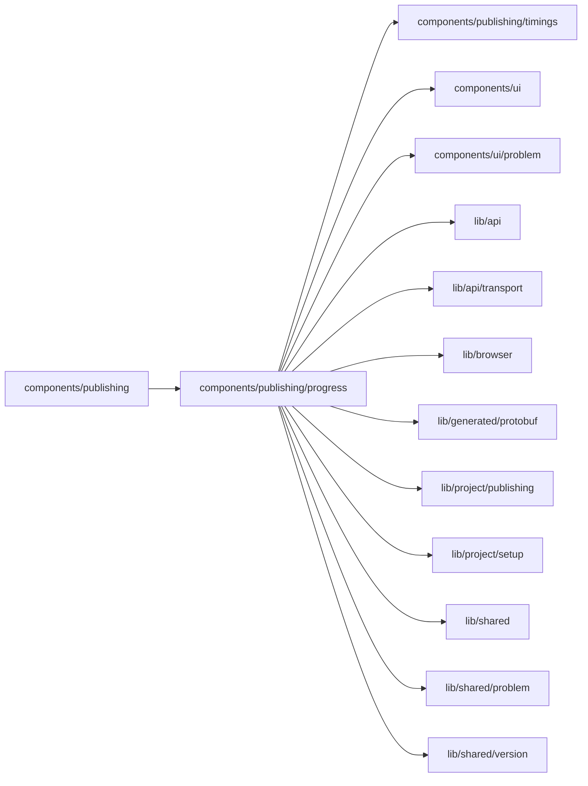

# Publish progress

<!-- BEGIN GENERATED DIRECTORY SUMMARY (scripts/check-readmes.mjs; edit only Purpose) -->
Purpose: One publish in Tools ▸ Publishing: its header with Cancel, the five-stage bar, a failure's problem, and the inline build log.

Importers: `components/publishing` imports this directory.

Imports: it imports `components/publishing/timings`, `components/ui`, `components/ui/problem`, `lib/api`, `lib/api/transport`, `lib/browser`, `lib/generated/protobuf`, `lib/project/publishing`, `lib/project/setup`, `lib/shared`, `lib/shared/problem` and `lib/shared/version`.

<!-- END GENERATED DIRECTORY SUMMARY -->

`PublishProgress` shows the publish in progress or the last one: "Publishing V13 · Started … by …",
"Published V13 · took …", "V13 didn't go live · Live still runs V12" with the problem panel under the bar,
or "Publishing cancelled · Live still runs V12".

`StageBar` draws **Check → Lock settings → Build → Deploy → Go live** (Deploy and Go live for a rollback)
from `lib/project/publishing/publish-stages.ts`: the configuration freeze comes before the build, as the
Release Flow records it. On a narrow panel only the running, failed or cancelled stage keeps its name.

`CancelPublish` confirms briefly that the running Live is untouched, then sends `CancelReleaseBuild`
while the build can be cancelled; a refusal `RELEASE_BUILD_DEPLOYING` names the deployment
(`deploymentId`), which it cancels with `CancelDeployment` instead. It is disabled once the health check
passed (`VerifyReadiness`), and a late refusal `DEPLOYMENT_NOT_CANCELLABLE` reads "Too late to cancel".
Each target keeps one request ID, so a repeated click is the same cancellation.

`PublishLog` is the inline log under the bar ("View logs" / "Hide logs"), grouped by stage, monospace:
the build's redacted output (`useBuildLog`, read only while it is open, at most every 2 seconds or the
server's `retry_after_ms`), and the publish's recorded phases, cancellation and failure from the
snapshots (`log-lines.ts`). There is no deployment log store. New lines keep it scrolled to the end unless
the reader scrolled up; only the log box scrolls.
