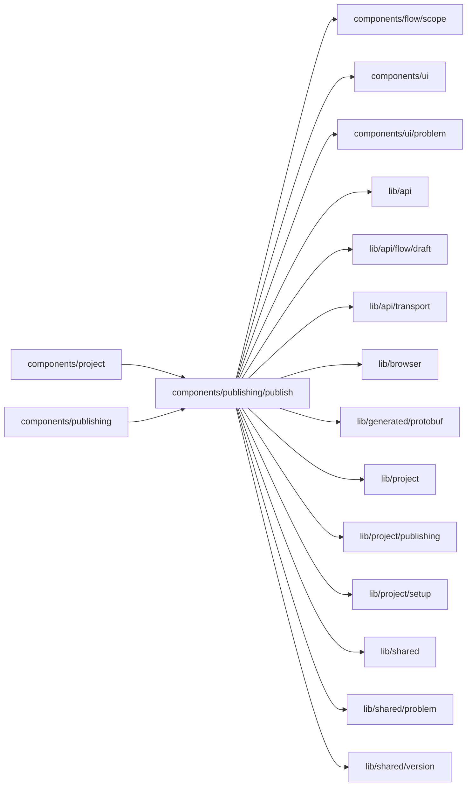

# Publish popover

<!-- BEGIN GENERATED DIRECTORY SUMMARY (scripts/check-readmes.mjs; edit only Purpose) -->
Purpose: The bar's Publish button and its popover: the version, what blocks it, what to check, what happens, the skip reason, and Publish.

Importers: `components/project` and `components/publishing` import this directory.

Imports: it imports `components/flow/scope`, `components/ui`, `components/ui/problem`, `lib/api`, `lib/api/flow/draft`, `lib/api/transport`, `lib/browser`, `lib/generated/protobuf`, `lib/project`, `lib/project/publishing`, `lib/project/setup`, `lib/shared`, `lib/shared/problem` and `lib/shared/version`.

<!-- END GENERATED DIRECTORY SUMMARY -->

`PublishButton` sits in the Builder bar. It is the one primary action, in green, whenever a version is
ahead of Live or settings wait for a publish, on either tab. On the Preview tab it counts the versions ahead
of Live ("2 new"); on the Live tab, and on the Preview tab when no version
is ahead, it counts the settings waiting for a publish ("1 waiting") and opens on Live's own version, so a
Next publish change publishes from either tab. While a publish runs (`usePublishProgress`) it reads
"Publishing…" and is disabled.

`PublishPopover` is a `PopoverCard`, not a dialog wizard:

- **Version** (`VersionChoice`): the newest version ahead of Live, the others folded behind "Another
  version (N more ahead of Live)", each with its Preview validation ("ran on Preview at …" or "not in the
  Preview record"; an evicted start is never "never ran").
- **Set up for Live first** and **Check** (`PublishChecks`): each gap of Live's next publish checked
  against the version, with "Set up ›" to its Setup row on the tab shown (the item's Next publish anchor,
  `nextPublishGapAnchor`, which unfolds the row and focuses its Next publish control), and what deserves a look without blocking, such as a trigger listening where Preview listens,
  with "Pick ›". A secret or an address-bound connection says why it cannot follow Preview.
- **Summary** (`ConsequenceSummary`): one line, such as "Replaces V12 · 2 setting changes · about 3 min",
  then **Details**, folded: the version replaced or a first publish, the processes that change, new,
  waiting and no longer used settings, address-bound connections, the connections Live uses (folded,
  `LiveIdentitiesSurface`), and the previous publish's durations. Checks read one line per concern.
- **Reason**: only for a version not in the Preview record, required, at most 500 code points, sent as
  `preview_skip_reason`. The prototype's checkbox is not adopted.
- **Publish** (`publish-commands.ts`): writes what Setup still holds for the layer, builds the version's
  frozen copy with `DeriveLiveConfiguration` at the layer and Preview revisions the popover showed, then
  `StartReleaseBuild` with `auto_deploy` fenced on the Live revision shown. A revision that moved
  (`REVISION_CHANGED`, `RELEASE_CONFIGURATION_STALE`) is read again and the popover says what changed.
  Once admitted the popover closes and Tools ▸ Publishing opens on the build (`?release=&build=`).

The popover prepares a version's Release when it has none (`usePublishCheck`), never again for one whose
preparation failed, and checks the Preview's own source meanwhile.

The bar's Publish is the one way in. On the Live tab it opens on Live's own version, which publishes it
again with its waiting settings (the build records `LIVE_CODE`, no reason); with nothing waiting it offers
"Publish V12 again", the same code and settings rebuilt. `publish-opener.ts` lets a page open the popover:
a failed publish's "Publish again" in Tools ▸ Publishing (`openPublishPopover`).
