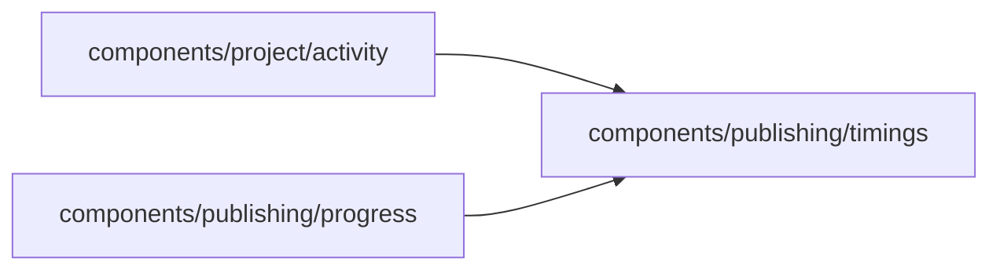

# Phase timings

<!-- BEGIN GENERATED DIRECTORY SUMMARY (scripts/check-readmes.mjs; edit only Purpose) -->
Purpose: Where the time of a Release build, a source preparation or a deployment went: one row per measured phase, with the labels of the phase codes.

Importers: `components/project/activity` and `components/publishing/progress` import this directory.

Imports: it imports no other Studio directory and calls no remote API.

<!-- END GENERATED DIRECTORY SUMMARY -->
