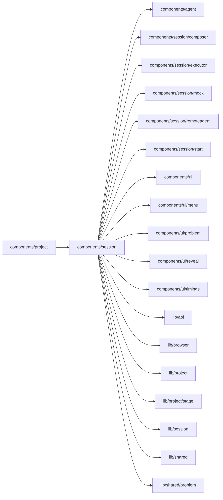

# Session UI

<!-- BEGIN GENERATED DIRECTORY SUMMARY (scripts/check-readmes.mjs; edit only Purpose) -->
Purpose: Binds the page's Session to the Agent UI: the chat and its rail, composer or mock composer, model picker, pending action dock, status, workspace renewal and startup phases.

Importers: `components/project` imports this directory.

Imports: it imports `components/agent`, `components/session/composer`, `components/session/executor`, `components/session/mock`, `components/session/remoteagent`, `components/session/start`, `components/ui`, `components/ui/menu`, `components/ui/problem`, `components/ui/reveal`, `components/ui/timings`, `lib/api`, `lib/browser`, `lib/project`, `lib/project/stage`, `lib/session`, `lib/shared` and `lib/shared/problem`.

<!-- END GENERATED DIRECTORY SUMMARY -->

The `remoteagent` child owns the Connect dialog, acknowledgement and one-time
code; `SessionChatStatus` supplies its Project identity and Builder capability.
Requests use the thin typed Studio API and remain outside shared Agent UI.
Executor mode/menu belongs to RAEXEC.
