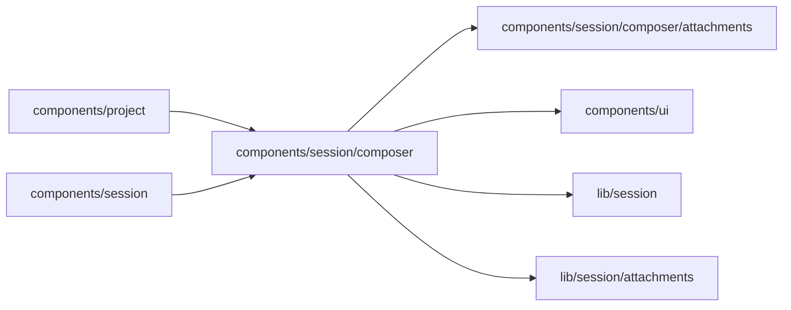

# Composer

<!-- BEGIN GENERATED DIRECTORY SUMMARY (scripts/check-readmes.mjs; edit only Purpose) -->
Purpose: The one message input, large on the start page and compact in the chat, with its About chip and the element picker that fills it.

Importers: `components/project` and `components/session` import this directory.

Imports: it imports `components/session/composer/attachments`, `components/ui`, `lib/session` and `lib/session/attachments`.

<!-- END GENERATED DIRECTORY SUMMARY -->
