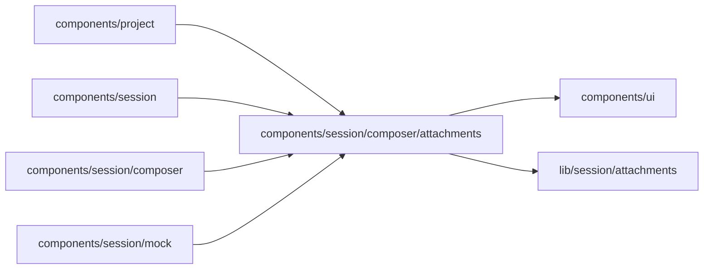

# Composer attachments

<!-- BEGIN GENERATED DIRECTORY SUMMARY (scripts/check-readmes.mjs; edit only Purpose) -->
Purpose: The composer's attachment controls: Attach (+) with its file picker, the chips with their progress and reasons, and the drop zone that takes files dropped on the chat.

Importers: `components/project`, `components/session`, `components/session/composer` and `components/session/mock` import this directory.

Imports: it imports `components/ui` and `lib/session/attachments`.

<!-- END GENERATED DIRECTORY SUMMARY -->
