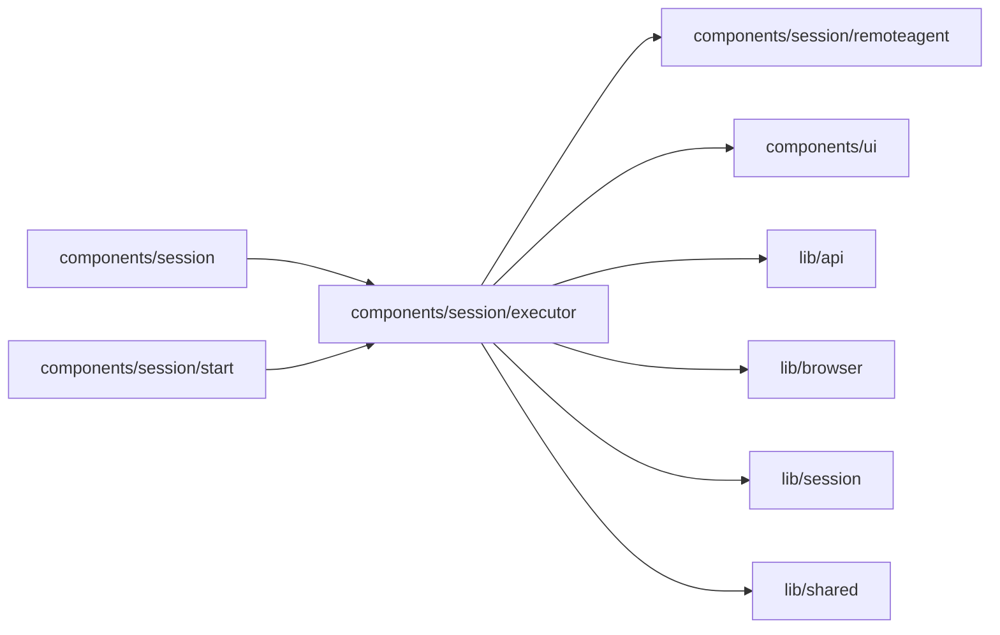

# Session executor controls

<!-- BEGIN GENERATED DIRECTORY SUMMARY (scripts/check-readmes.mjs; edit only Purpose) -->
Purpose: Shows the composer's Agent picker, SQL-derived remote liveness, offline notice, pairing entry and epoch-fenced return to Superverse.

Importers: `components/session` and `components/session/start` import this directory.

Imports: it imports `components/session/remoteagent`, `components/ui`, `lib/api`, `lib/browser`, `lib/session` and `lib/shared`.

<!-- END GENERATED DIRECTORY SUMMARY -->

The canonical Session resource supplies executor authority and SQL last-seen metadata. Ninety seconds without a last-seen update displays offline; that label never switches execution. The UI clock refreshes liveness and Send availability and makes no request.
The existing Session Watch includes SQL last-seen updates; no extra poll is added.
Offline keeps the draft editable, disables new sends and retains already queued
messages for reconnect. It changes no server admission or executor authority.

Operators can read the executor label and remote liveness. Only Builders can connect an agent or switch execution; the server checks that capability independently of the menu.

Studio sends the exact protobuf epoch string with `SetSessionExecutor`, then refreshes through the existing Session owner and its stale-response guards. Project, permission, Session status or executor epoch/generation changes unmount the command owner and abort its request. Refusal or response loss also refreshes canonical state without retrying the command. The server authorizes every command and rejects stale epochs.

The composer holds one Agent picker for both platform and remote modes. Its
first level chooses Superverse or a local agent. The Superverse level lists
models only while platform execution is current; remote mode offers the
epoch-fenced switch back. The local level shows liveness and opens the
Project-keyed RAPAIR dialog. Escape and outside press close the picker;
its nested levels retain keyboard focus. The remote composer accepts ordinary
Orca input and hides the mock composer. Shared Agent conversation UI receives
only the existing public message projection and labels remote assistant replies.

An absent executor on a present agent description renders the legacy
Superverse selection and permission-gated Connect action only. It creates no
executor state or epoch and never offers switching. Mock Studio fixtures do
not implement executor switching; their authorized command returns 503.
