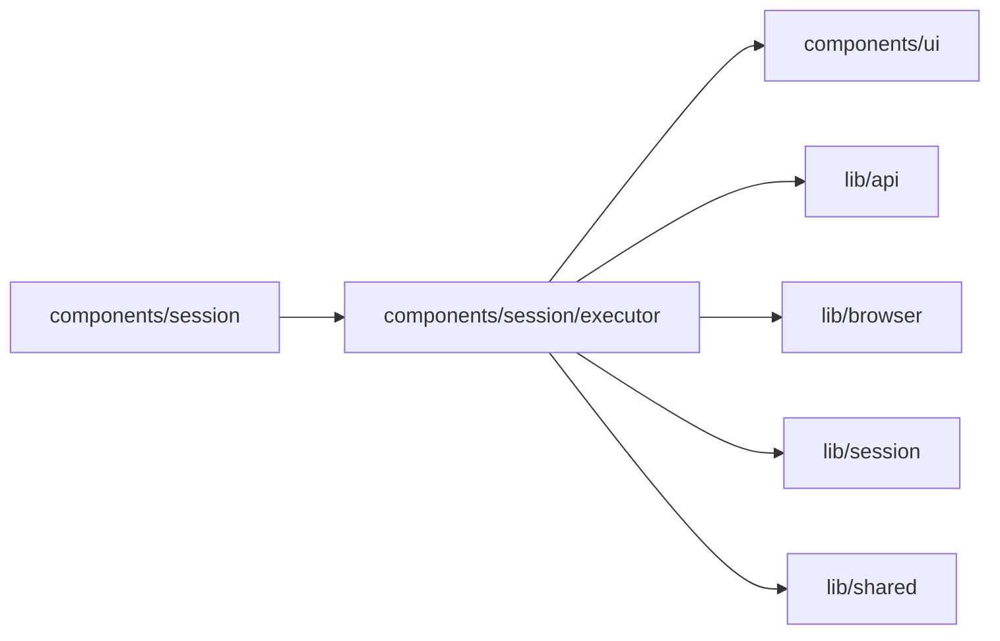

# Session executor controls

<!-- BEGIN GENERATED DIRECTORY SUMMARY (scripts/check-readmes.mjs; edit only Purpose) -->
Purpose: Shows the Session executor, SQL-derived remote liveness, offline notice, and epoch-fenced return to Superverse while keeping connection dialog ownership with its caller.

Importers: `components/session` imports this directory.

Imports: it imports `components/ui`, `lib/api`, `lib/browser`, `lib/session` and `lib/shared`.

<!-- END GENERATED DIRECTORY SUMMARY -->

The canonical Session resource supplies executor authority and SQL last-seen metadata. Ninety seconds without a last-seen update displays offline; that label never switches execution. The UI clock refreshes only this label and makes no request.

Operators can read the executor label and remote liveness. Only Builders can connect an agent or switch execution; the server checks that capability independently of the menu.

Studio sends the exact protobuf epoch string with `SetSessionExecutor`, then refreshes through the existing Session owner and its stale-response guards. Project, permission, Session status or executor epoch/generation changes unmount the command owner and abort its request. Refusal or response loss also refreshes canonical state without retrying the command. The server authorizes every command and rejects stale epochs.

The header passes the RAPAIR connection dialog opener to `SessionExecutorStatus`; this directory does not create another dialog. The remote composer accepts ordinary Orca input, while the platform model picker and mock composer are hidden in remote mode. Shared Agent conversation UI receives only the existing public message projection and labels remote assistant replies.

The Project Builder passes its Project identity and build permission to `SessionChatStatus`, which hosts this menu and the single Project-keyed connection dialog. Browser pairing, reply, takeover and offline acceptance remains unrun; source changes do not establish runtime evidence.

An absent executor on a present agent description renders the legacy Superverse label and permission-gated Connect action only. It creates no executor state or epoch and never offers switching. The development dialog fixtures do not implement executor switching; their authorized command explicitly returns 503.
