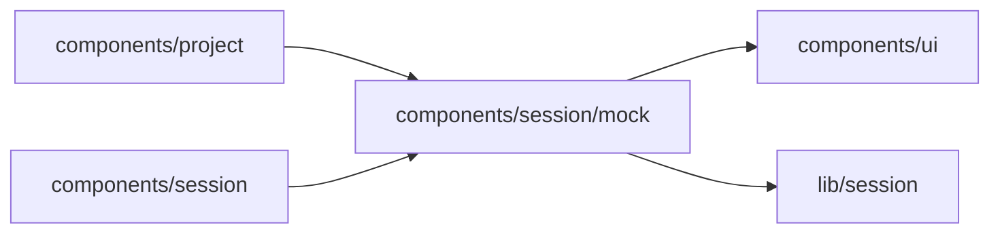

# components/session/mock

<!-- BEGIN GENERATED DIRECTORY SUMMARY (scripts/check-readmes.mjs; edit only Purpose) -->
Purpose: The mock model's composer, in a Session and on the creation page: it picks a category, a scenario and its arguments, and sends the next input as its kind arrives.

Importers: `components/project` and `components/session` import this directory.

Imports: it imports `components/ui` and `lib/session`.

<!-- END GENERATED DIRECTORY SUMMARY -->
