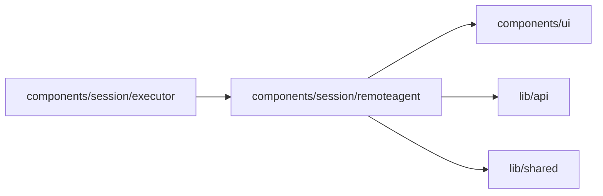

# Remote agent dialog

<!-- BEGIN GENERATED DIRECTORY SUMMARY (scripts/check-readmes.mjs; edit only Purpose) -->
Purpose: Shows Builder connection risk acknowledgement, one-time pairing and safe connection metadata through Studio's typed business API.

Importers: `components/session/executor` imports this directory.

Imports: it imports `components/ui`, `lib/api` and `lib/shared`.

<!-- END GENERATED DIRECTORY SUMMARY -->

The native modal preserves keyboard focus and Escape. Requests have cancellation
and a stale-response fence; closing or changing the Project discards dialog
state. The inner component is keyed by Project so another owner cannot retain
old acknowledgement or connection metadata. The code has an accessible label,
removal names its owner, and the wait text asks for explicit Refresh connections.
Code/countdown is local and never periodic Flow polling; the code is hidden and
the timer stops at expiry. Creation times use the browser's readable locale. Current
connection/owner is read on open or explicit actions/refresh and is distinct
from PAIRED credentials. The shared Agent conversation remains transport-free;
the composer's Agent picker owns the Connect entry and mode selection. Studio mock mode supplies typed pairing/list/removal fixtures only; executor switching is explicitly unavailable (503), with no token, provider binding or invented executor state. Code/token fields must never enter browser
recordings or public evidence. See [connection operation](../../../../../docs/runbooks/remote-agent.md).
