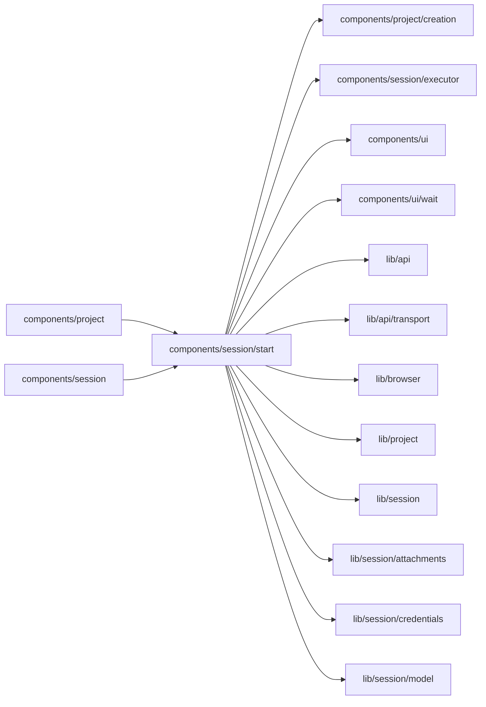

# components/session/start

<!-- BEGIN GENERATED DIRECTORY SUMMARY (scripts/check-readmes.mjs; edit only Purpose) -->
Purpose: The composer around a Session's turns: the starting model the creation page preselects, the composer's text per Project and its send.

Importers: `components/project` and `components/session` import this directory.

Imports: it imports `components/project/creation`, `components/session/executor`, `components/ui`, `components/ui/wait`, `lib/api`, `lib/api/transport`, `lib/browser`, `lib/project`, `lib/session`, `lib/session/attachments`, `lib/session/credentials` and `lib/session/model`.

<!-- END GENERATED DIRECTORY SUMMARY -->

`useLocalCreation` owns the browser-side admission of a local creation's first
message. The Project-scoped intent stays in session storage while the editable
composer text uses its existing per-Project browser storage. Remote activation
sends the current draft once; clearing it before connection leaves subsequent
messages manual. An example's draft is always manual. Automatic and manual
Send share the persisted sending marker, and neither updates the platform model.
A lost response is never retried automatically, including after reload. A queued
message with the exact ID proves admission; otherwise `LocalCreationNotice`
requires checking the conversation before explicitly enabling manual sending.
The marker retains the actual submitted text, so reconciliation does not erase
edits made while a request was in flight. Each pending Project has one record,
removed after admission or explicit manual reconciliation; session storage ends
with the browser tab. No cloud resource, Flow primitive or database is added.

The shared executor liveness helper also blocks new sends while an existing
remote Session is offline. The existing Session Watch supplies SQL last-seen;
its ninety-second display threshold never changes authority or queued work.
The draft remains editable and survives reload, and reconnect enables Send.

StartingModelPicker renders the composer's shared authenticated ProviderModelChoices
and ModelCredentialEntry. It offers only catalog models, with Mock where offered.
A pre-Project key is staged only in memory; custom discovery requires the accepted
Project. Context and output controls use the shared BYOKCONTEXT entry.

useStartingCreation wraps local creation without changing its send ownership.
For a provider-backed creation, the Project opens with an editable draft and no
initial server message. The in-memory key is admitted through SetModelCredential
before automatic delivery. Failure retains the draft and shows the credential
error; the Agent picker admits a replacement. Reload drops staged keys and
automatic delivery, retaining only the ordinary draft. An uncertain send is
never repeated automatically. Example drafts stay manual.

Before a platform first Send crosses the RPC boundary, a session-storage marker
records only its non-secret message admission ID. Success clears it. A failed or
lost response retains it across reload and requires checking the conversation
before explicitly enabling another manual send; no credential or message content
is stored in that marker. It expires with the browser tab or explicit resolution.
