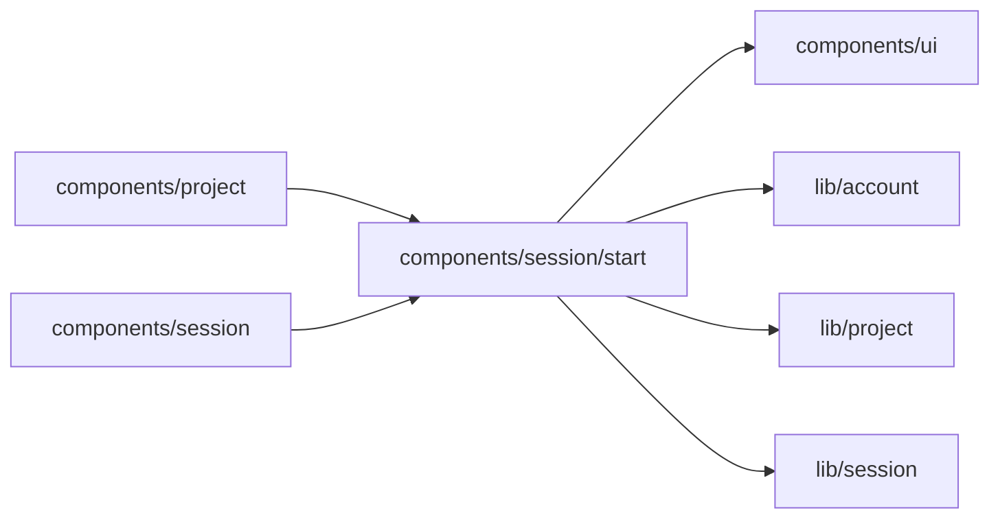

# components/session/start

<!-- BEGIN GENERATED DIRECTORY SUMMARY (scripts/check-readmes.mjs; edit only Purpose) -->
Purpose: A new Session's first turn and the composer's send: the starting model, the creation intent the chat sends once the Session waits, and replies to a waiting card.

Importers: `components/project` and `components/session` import this directory.

Imports: it imports `components/ui`, `lib/account`, `lib/project` and `lib/session`.

<!-- END GENERATED DIRECTORY SUMMARY -->
