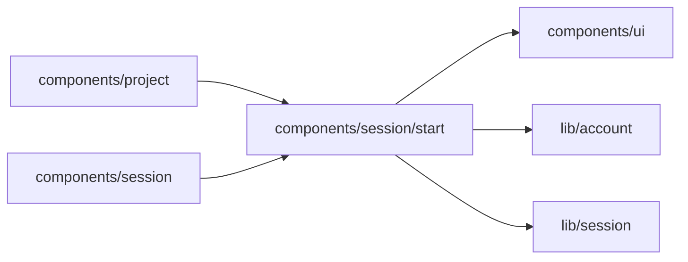

# components/session/start

<!-- BEGIN GENERATED DIRECTORY SUMMARY (scripts/check-readmes.mjs; edit only Purpose) -->
Purpose: The composer around a Session's turns: the starting model the creation page preselects, the composer's text per Project and its send.

Importers: `components/project` and `components/session` import this directory.

Imports: it imports `components/ui`, `lib/account` and `lib/session`.

<!-- END GENERATED DIRECTORY SUMMARY -->
