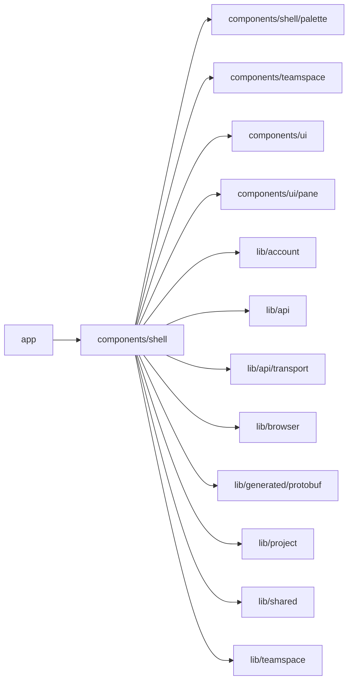

# App shell

<!-- BEGIN GENERATED DIRECTORY SUMMARY (scripts/check-readmes.mjs; edit only Purpose) -->
Purpose: The app frame: the sign-in and registration form, the signed-in sidebar with its rail, Projects, Team, theme and account, the account pages' bar, and the brand marks.

Importers: `app` imports this directory.

Imports: it imports `components/shell/palette`, `components/teamspace`, `components/ui`, `components/ui/pane`, `lib/account`, `lib/api`, `lib/api/transport`, `lib/browser`, `lib/generated/protobuf`, `lib/project`, `lib/shared` and `lib/teamspace`.

<!-- END GENERATED DIRECTORY SUMMARY -->

The sidebar works in the current Teamspace (`lib/teamspace`): its switcher row opens the person's Teamspaces,
SidebarProjects lists every Project of the Teamspace with the person's role in it and refreshes them, and the Team
section below them (Connections, then People) stays in view while the Projects scroll. A Project in
which the person has no role carries only its name, status, setup status and Live presence and is not a link, because
its page cannot load. A Project with a role links to its Builder.
