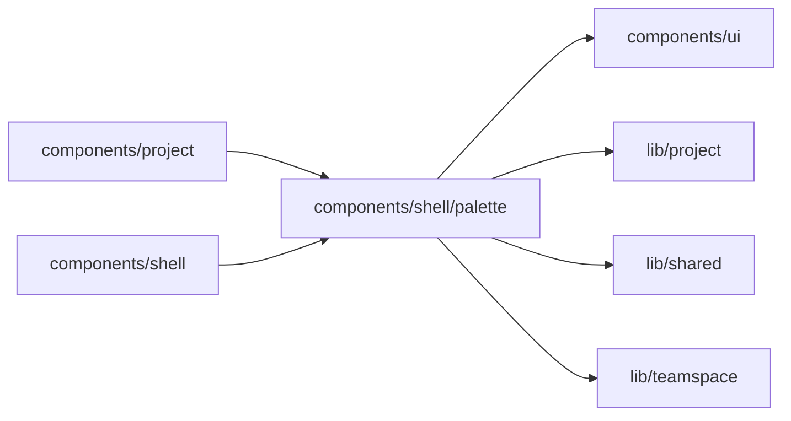

# Jump to

<!-- BEGIN GENERATED DIRECTORY SUMMARY (scripts/check-readmes.mjs; edit only Purpose) -->
Purpose: Jump to (⌘K or Ctrl K): Home, New project, every Project, and the Processes, surfaces and tools the open Builder offers.

Importers: `components/project` and `components/shell` import this directory.

Imports: it imports `components/ui`, `lib/project`, `lib/shared` and `lib/teamspace`.

<!-- END GENERATED DIRECTORY SUMMARY -->
