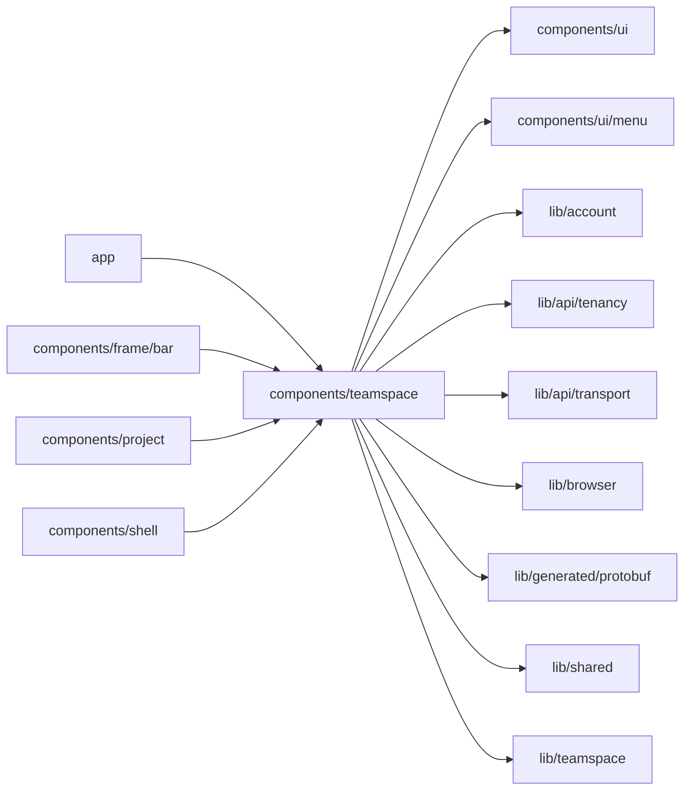

# TeamSpace pages

<!-- BEGIN GENERATED DIRECTORY SUMMARY (scripts/check-readmes.mjs; edit only Purpose) -->
Purpose: The TeamSpace switcher, creation and landing, page gate, Home header, People, a Project's Permissions and Share, and the Project role chip.

Importers: `app`, `components/frame/bar`, `components/project` and `components/shell` import this directory.

Imports: it imports `components/ui`, `components/ui/menu`, `lib/account`, `lib/api/tenancy`, `lib/api/transport`, `lib/browser`, `lib/generated/protobuf`, `lib/shared` and `lib/teamspace`.

<!-- END GENERATED DIRECTORY SUMMARY -->

The pages read the TeamSpace through `lib/teamspace`'s provider, which the workspace layout owns, so the sidebar and
the page share one read. A TeamSpace created a moment ago is waited for, since it reaches the read model within
seconds. Every write runs through `useSingleFlight`; a rename fenced on a revision that changed answers
`REVISION_CHANGED`, which the header reports before showing the TeamSpace as it is now. Only the platform admin
sees Delete TeamSpace, which asks for the TeamSpace's name.

People and Permissions share `MemberTable`. Only a TeamSpace's admins (and the platform admin) change its members,
and only a Project's owners (the platform admin reads as one) change the Project's; the only admin or owner has no
select or Remove, and a member who left the TeamSpace stays listed in a Project with a role that grants nothing.
Every change answers with all the members, which the page shows at once; a rule the server refuses, such as
removing the only owner of a Project, shows the server's message.

`ProjectShare` is the bar's Share: an owner adds a member of the TeamSpace with a role through `AddProjectMember`,
the same form Permissions shows, and anyone copies the link to the page shown.
