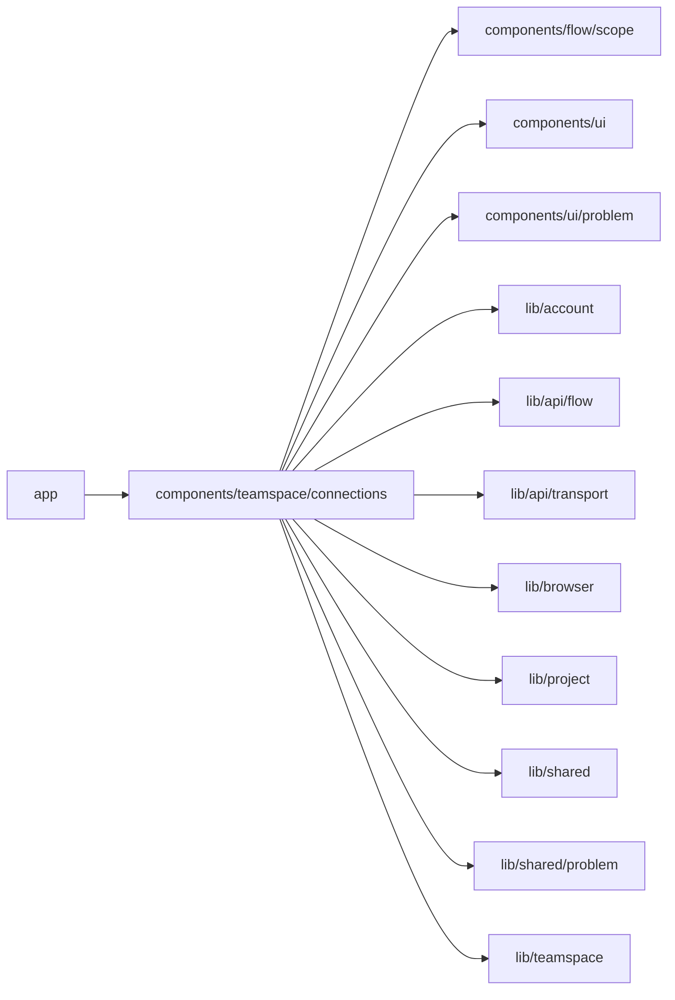

# components/teamspace/connections

<!-- BEGIN GENERATED DIRECTORY SUMMARY (scripts/check-readmes.mjs; edit only Purpose) -->
Purpose: The Teamspace's Connections page: its connections by connector and major version, the Projects using each, and their creation, editing and deletion.

Importers: `app` imports this directory.

Imports: it imports `components/flow/scope`, `components/ui`, `components/ui/problem`, `lib/account`, `lib/api/flow`, `lib/api/transport`, `lib/browser`, `lib/project`, `lib/shared`, `lib/shared/problem` and `lib/teamspace`.

<!-- END GENERATED DIRECTORY SUMMARY -->

The database owns the connections; Go decides who may change them. The pages
leave out the actions a caller's roles cannot take (a Teamspace admin, the
platform admin, or an owner or builder of one of its Projects manages them)
and otherwise show Go's refusal.

- `ConnectionsPage` lists the Teamspace's apps, one `AppCard` each, those that
  need someone first; a `ConnectionRow` says which Projects use the connection
  on Preview (P) and Live (L), opens its editor in place with what a change
  reaches, and keeps Delete blocked while a Project uses it. "Add another"
  opens a new connection of the app in its card under the next free name, and
  a few suggestions lead to the catalog.
- `BrowseApps` (`/t/<id>/connections/browse`) is the catalog, searchable, with
  each app's logo (`AppLogo`: the release's SVG as an image, or initials) and
  what the Teamspace already has of it; `?app=<connector>` opens one app's
  editor at once. Saving returns to Connections.
- `connection-words.ts` holds the words both pages use: Connected, Sign in
  again, Sign-in not finished (only a copy to a new major version, or a
  connection made before sign-in created connections) and the reach of a
  change. `use-connections.ts` reads what both pages need.

An authorization returns to Connections with `oauth` and, on failure, the
refusal's `reason`, which the page says once.
