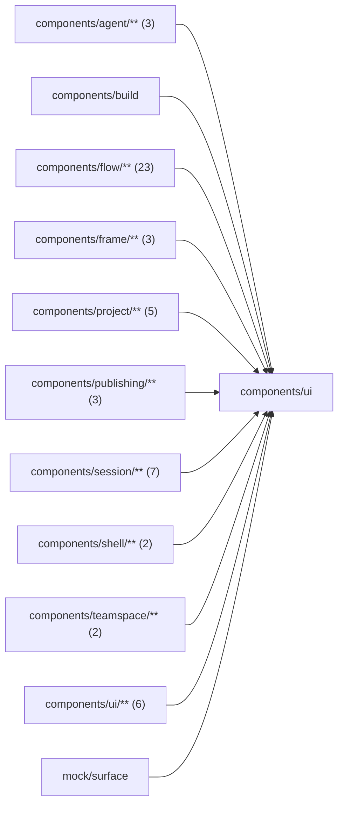

# UI primitives

<!-- BEGIN GENERATED DIRECTORY SUMMARY (scripts/check-readmes.mjs; edit only Purpose) -->
Purpose: Product-free UI primitives: the class joiner `cx`, Button, Dialog, Popover, Banner, Chip and Eyebrow, icons and glyphs, the phase timing list and the not-ready placeholder, with resizable panes in `pane/`.

Importers: `components/agent/**` (3), `components/build`, `components/flow/**` (23), `components/frame/**` (3), `components/project/**` (5), `components/publishing/**` (3), `components/session/**` (7), `components/shell/**` (2), `components/teamspace/**` (2), `components/ui/**` (6) and `mock/surface` import this directory.

Imports: it imports no other Studio directory and calls no remote API.

<!-- END GENERATED DIRECTORY SUMMARY -->
