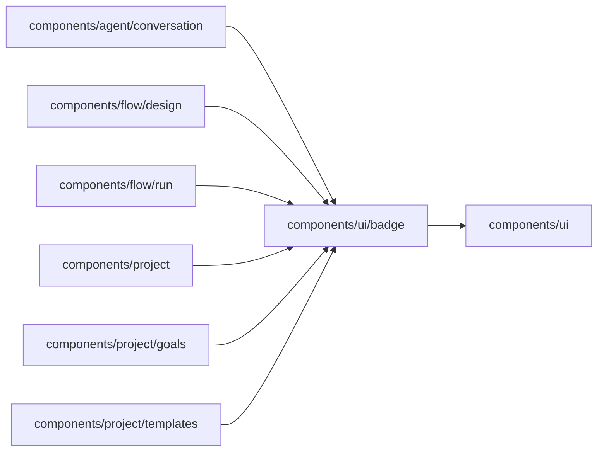

# Badge

<!-- BEGIN GENERATED DIRECTORY SUMMARY (scripts/check-readmes.mjs; edit only Purpose) -->
Purpose: The one small pill for a state, a count or a label beside a name, in the five tones the palette licenses.

Importers: `components/agent/conversation`, `components/flow/design`, `components/flow/run`, `components/project`, `components/project/goals` and `components/project/templates` import this directory.

Imports: it imports `components/ui`.

<!-- END GENERATED DIRECTORY SUMMARY -->
