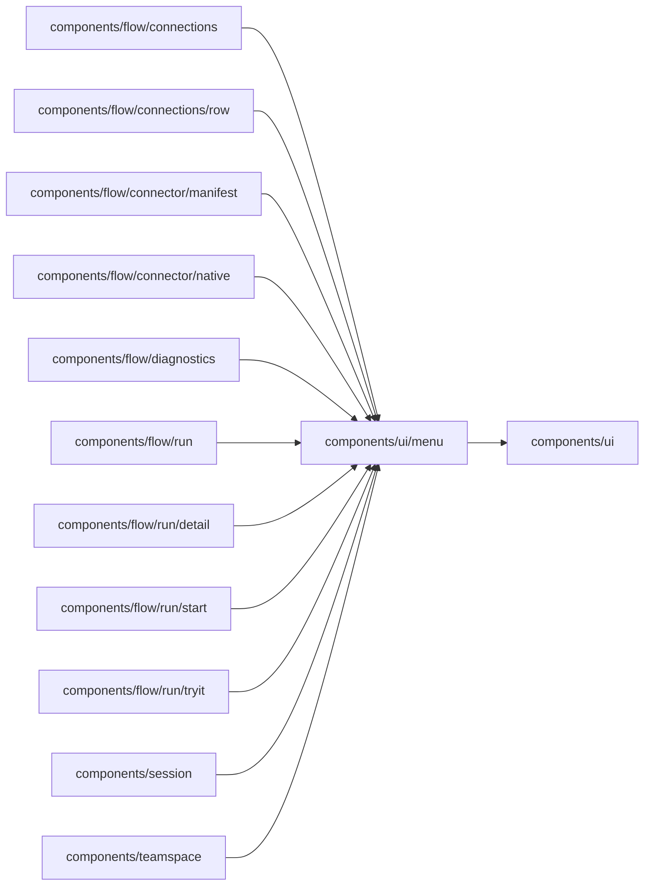

# Dropdown

<!-- BEGIN GENERATED DIRECTORY SUMMARY (scripts/check-readmes.mjs; edit only Purpose) -->
Purpose: The one dropdown for every single choice, on the popover card, with its rows and listbox keyboard handling.

Importers: `components/flow/connections`, `components/flow/connections/row`, `components/flow/connector/manifest`, `components/flow/connector/native`, `components/flow/diagnostics`, `components/flow/run`, `components/flow/run/detail`, `components/flow/run/start`, `components/flow/run/tryit`, `components/session` and `components/teamspace` import this directory.

Imports: it imports `components/ui`.

<!-- END GENERATED DIRECTORY SUMMARY -->
