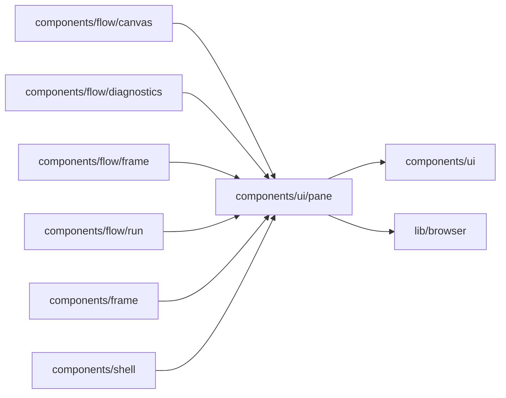

# Resizable panes

<!-- BEGIN GENERATED DIRECTORY SUMMARY (scripts/check-readmes.mjs; edit only Purpose) -->
Purpose: Resizable panes: the pixel resize handle with its rail and remembered width, the list column, and the drag and keyboard gestures they share.

Importers: `components/flow/canvas`, `components/flow/diagnostics`, `components/flow/frame`, `components/flow/run`, `components/frame` and `components/shell` import this directory.

Imports: it imports `components/ui` and `lib/browser`.

<!-- END GENERATED DIRECTORY SUMMARY -->
