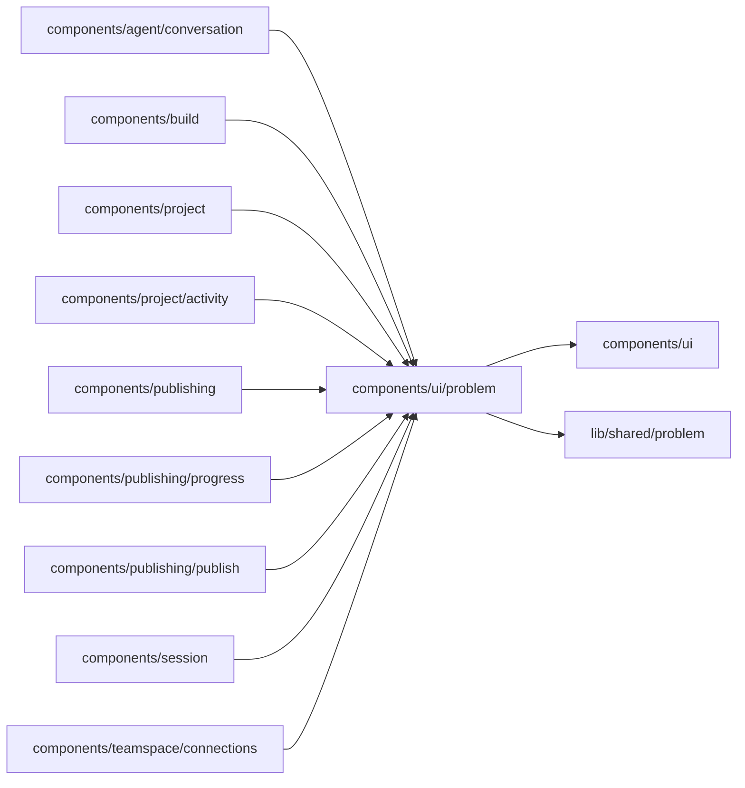

# components/ui/problem

<!-- BEGIN GENERATED DIRECTORY SUMMARY (scripts/check-readmes.mjs; edit only Purpose) -->
Purpose: The one problem panel every failure uses: what happened, why, one remedy button and the folded technical details.

Importers: `components/agent/conversation`, `components/build`, `components/project`, `components/project/activity`, `components/publishing`, `components/publishing/progress`, `components/publishing/publish`, `components/session` and `components/teamspace/connections` import this directory.

Imports: it imports `components/ui` and `lib/shared/problem`.

<!-- END GENERATED DIRECTORY SUMMARY -->
