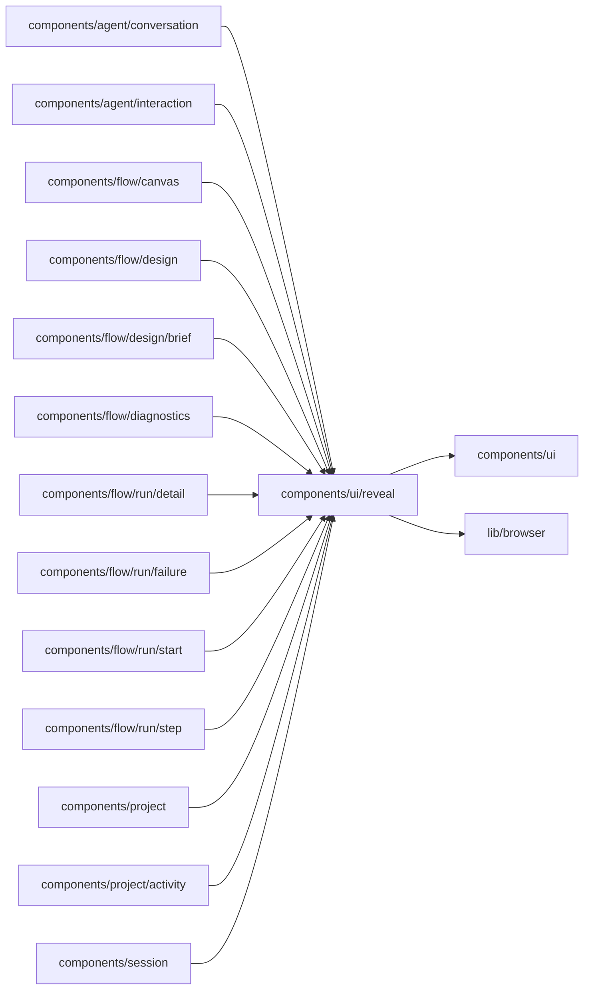

# More details

<!-- BEGIN GENERATED DIRECTORY SUMMARY (scripts/check-readmes.mjs; edit only Purpose) -->
Purpose: The "More details" fold every surface uses to keep engine detail out of its default view, remembered open per surface in this browser.

Importers: `components/agent/conversation`, `components/agent/interaction`, `components/flow/canvas`, `components/flow/design`, `components/flow/design/brief`, `components/flow/diagnostics`, `components/flow/run/detail`, `components/flow/run/failure`, `components/flow/run/start`, `components/flow/run/step`, `components/project`, `components/project/activity` and `components/session` import this directory.

Imports: it imports `components/ui` and `lib/browser`.

<!-- END GENERATED DIRECTORY SUMMARY -->
