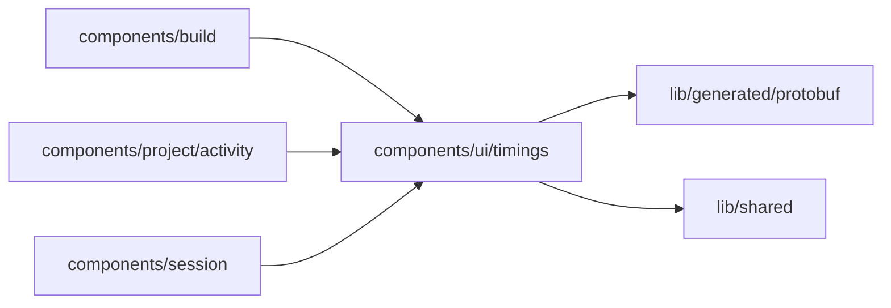

# components/ui/timings

<!-- BEGIN GENERATED DIRECTORY SUMMARY (scripts/check-readmes.mjs; edit only Purpose) -->
Purpose: The list of the phases a Preview start, a build or a deployment measured, each with its label and duration.

Importers: `components/build`, `components/project/activity` and `components/session` import this directory.

Imports: it imports `lib/generated/protobuf` and `lib/shared`.

<!-- END GENERATED DIRECTORY SUMMARY -->
