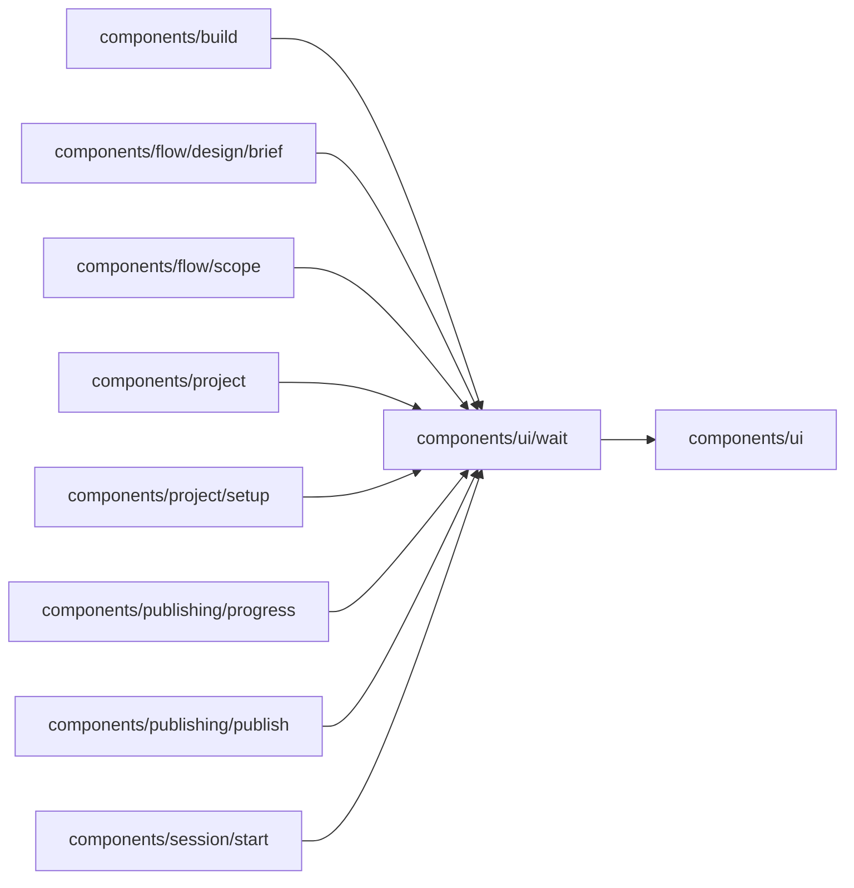

# components/ui/wait

<!-- BEGIN GENERATED DIRECTORY SUMMARY (scripts/check-readmes.mjs; edit only Purpose) -->
Purpose: The running Dex mark for a long wait: the brand tile GIF shown after a few seconds, with its reduced-motion still and polite status words.

Importers: `components/build`, `components/flow/design/brief`, `components/flow/scope`, `components/project`, `components/project/setup`, `components/publishing/progress`, `components/publishing/publish` and `components/session/start` import this directory.

Imports: it imports `components/ui`.

<!-- END GENERATED DIRECTORY SUMMARY -->

The mark sizes itself for where it sits: `line` (20px, no taller than the text beside it, with a spinner until
it runs), `panel` or `page`. A wait whose mark comes and goes with its words places it where it moves nothing,
such as after a heading; a wait that stops on the person keeps the box with the `still` frame. The image is the
running icon on its forest tile, the same in both themes so it reads as a deliberate tile on any ground; it is
fetched when the wait starts and fades in once loaded. Only marks of one named `chain` (the startup steps) hand
the animation on at once; every other mark waits out its own delay, so an unrelated quick wait never flashes it.
The images live in `public/brand`, copied from the canonical Pipe D set in dex-ui `logo/pipe-d`
(`gif/dex-running-icon-128.gif` and its first frame).
