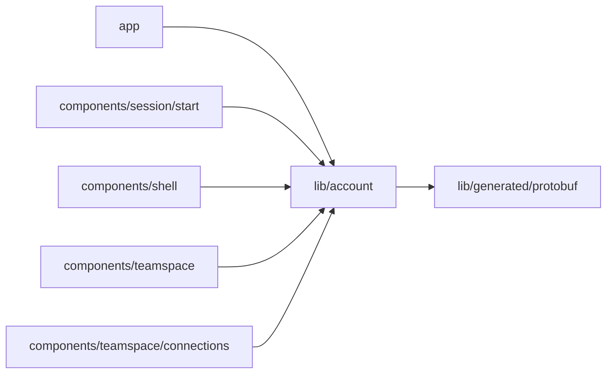

# Account provider

<!-- BEGIN GENERATED DIRECTORY SUMMARY (scripts/check-readmes.mjs; edit only Purpose) -->
Purpose: `AccountProvider`, which gives the signed-in pages the account their layout read once.

Importers: `app`, `components/session/start`, `components/shell`, `components/teamspace` and `components/teamspace/connections` import this directory.

Imports: it imports `lib/generated/protobuf`.

<!-- END GENERATED DIRECTORY SUMMARY -->
