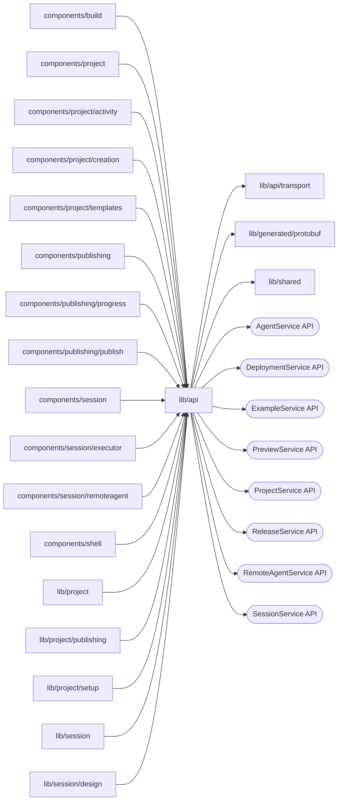

# Browser API clients

<!-- BEGIN GENERATED DIRECTORY SUMMARY (scripts/check-readmes.mjs; edit only Purpose) -->
Purpose: Browser clients of the BFF, one module per browser service with functions named after its RPCs, and the account client that reaches AccountService through `/api/auth`.

Importers: `components/build`, `components/project`, `components/project/activity`, `components/project/creation`, `components/project/templates`, `components/publishing`, `components/publishing/progress`, `components/publishing/publish`, `components/session`, `components/session/executor`, `components/session/remoteagent`, `components/shell`, `lib/project`, `lib/project/publishing`, `lib/project/setup`, `lib/session` and `lib/session/design` import this directory.

Imports: it imports `lib/api/transport`, `lib/generated/protobuf` and `lib/shared` and calls the `AgentService`, `DeploymentService`, `ExampleService`, `PreviewService`, `ProjectService`, `ReleaseService`, `RemoteAgentService` and `SessionService` APIs.

<!-- END GENERATED DIRECTORY SUMMARY -->

Every service function takes `(input, signal)`, where the input is the RPC's
request less only what the module derives.
Each module keeps its service's own rules: Project creation retries a 503,
validation checks its request ID, and the retry rule of `transport/api-error.ts`
decides what a failed command keeps. Get/List reads share the bounded transient
policy of [the transport](transport/README.md). The modules import only `lib/shared`,
`lib/generated` and `lib/api`, so the Agent enum mapping stays in
`lib/session/agent-view.ts`.
