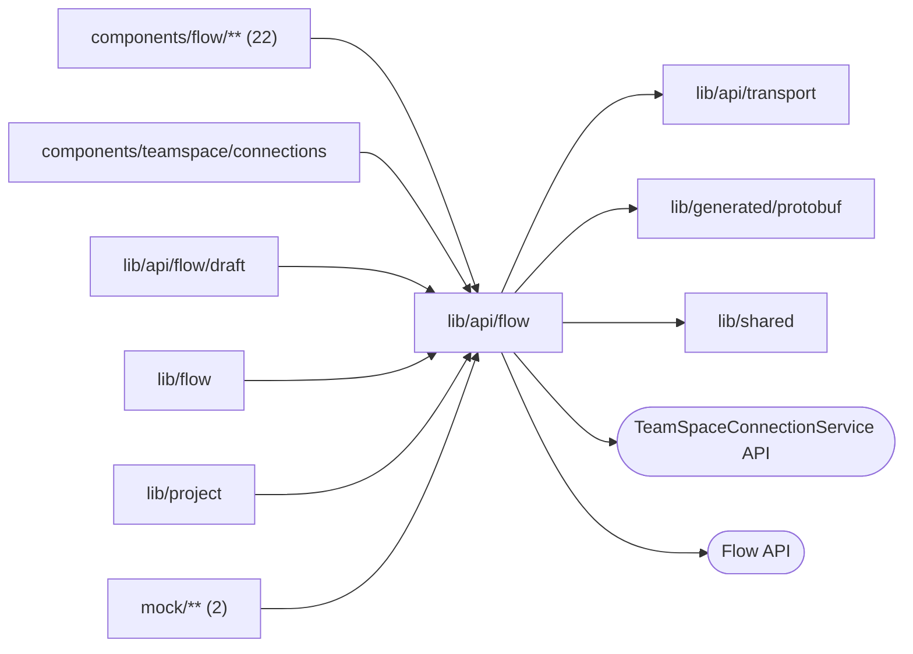

# Flow API documents and calls

<!-- BEGIN GENERATED DIRECTORY SUMMARY (scripts/check-readmes.mjs; edit only Purpose) -->
Purpose: Flow API documents and calls: definition and run wire types, status and history readers, blobs, and one module per Flow API service, so no component builds a Flow API path.

Importers: `components/flow/**` (22), `components/teamspace/connections`, `lib/api/flow/draft`, `lib/flow`, `lib/project` and `mock/**` (2) import this directory.

Imports: it imports `lib/api/transport`, `lib/generated/protobuf` and `lib/shared` and calls the `TeamSpaceConnectionService` and Flow APIs.

<!-- END GENERATED DIRECTORY SUMMARY -->
