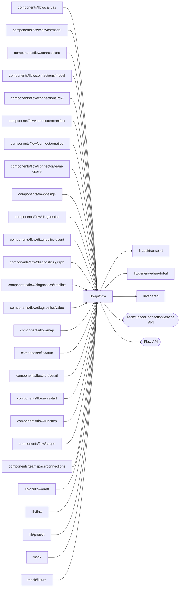

# Flow API documents and calls

<!-- BEGIN GENERATED DIRECTORY SUMMARY (scripts/check-readmes.mjs; edit only Purpose) -->
Purpose: Flow API documents and calls: definition and run wire types, status and history readers, blobs, and one module per Flow API service, so no component builds a Flow API path.

Importers: `components/flow/canvas`, `components/flow/canvas/model`, `components/flow/connections`, `components/flow/connections/model`, `components/flow/connections/row`, `components/flow/connector/manifest`, `components/flow/connector/native`, `components/flow/connector/team-space`, `components/flow/design`, `components/flow/diagnostics`, `components/flow/diagnostics/event`, `components/flow/diagnostics/graph`, `components/flow/diagnostics/timeline`, `components/flow/diagnostics/value`, `components/flow/map`, `components/flow/run`, `components/flow/run/detail`, `components/flow/run/start`, `components/flow/run/step`, `components/flow/scope`, `components/teamspace/connections`, `lib/api/flow/draft`, `lib/flow`, `lib/project`, `mock` and `mock/fixture` import this directory.

Imports: it imports `lib/api/transport`, `lib/generated/protobuf` and `lib/shared` and calls the `TeamSpaceConnectionService` and Flow APIs.

<!-- END GENERATED DIRECTORY SUMMARY -->
