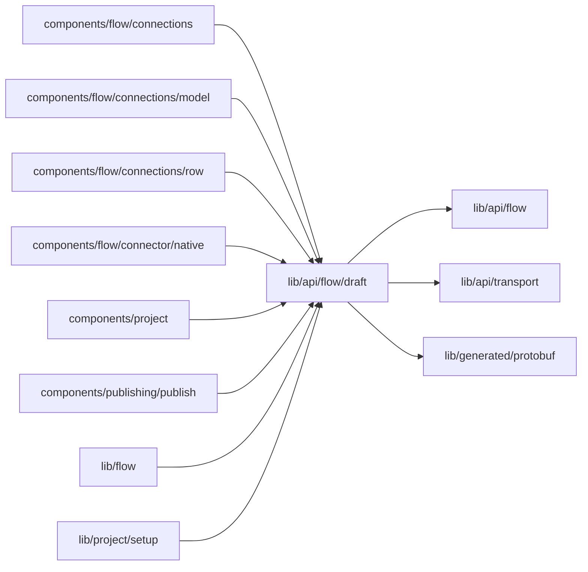

# Configuration drafts

<!-- BEGIN GENERATED DIRECTORY SUMMARY (scripts/check-readmes.mjs; edit only Purpose) -->
Purpose: The autosave queue of one configuration scope per tab: one compare-and-swap write at a time, each on the revision the previous returned.

Importers: `components/flow/connections`, `components/flow/connections/model`, `components/flow/connections/row`, `components/flow/connector/native`, `components/project`, `components/publishing/publish`, `lib/flow` and `lib/project/setup` import this directory.

Imports: it imports `lib/api/flow`, `lib/api/transport` and `lib/generated/protobuf`.

<!-- END GENERATED DIRECTORY SUMMARY -->

A typed change waits 500 ms after the last keystroke and a selection writes at once. A write
refused for a changed revision is written again on the new revision when the server still holds
the item as this tab read it; otherwise the item shows "Changed elsewhere" with yours or theirs.
Apply flushes the queue and sends the revision its last write returned. `next-publish-writes.ts` writes
an item of Live's next-publish layer: Live's own value, or "Same as Preview", the same route with
`followPreview`; a follower counts as unchanged against the value it resolved to.
