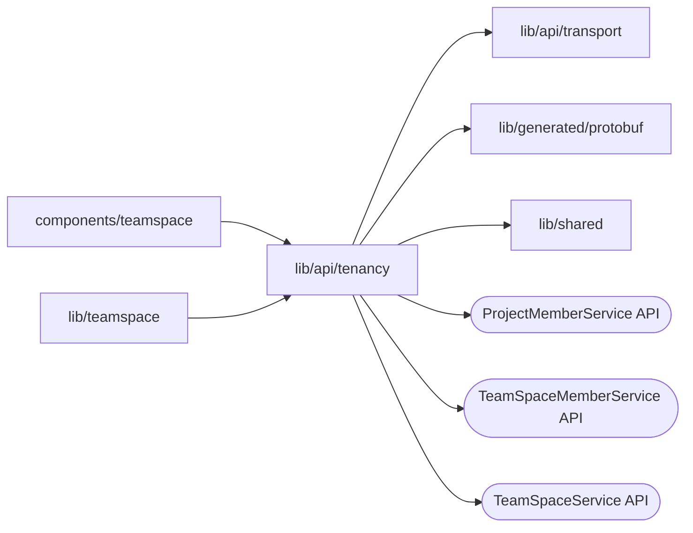

# Tenancy clients

<!-- BEGIN GENERATED DIRECTORY SUMMARY (scripts/check-readmes.mjs; edit only Purpose) -->
Purpose: Browser clients of TeamSpaceService, TeamSpaceMemberService and ProjectMemberService over the business RPC route.

Importers: `components/teamspace` and `lib/teamspace` import this directory.

Imports: it imports `lib/api/transport`, `lib/generated/protobuf` and `lib/shared` and calls the `ProjectMemberService`, `TeamSpaceMemberService` and `TeamSpaceService` APIs.

<!-- END GENERATED DIRECTORY SUMMARY -->
