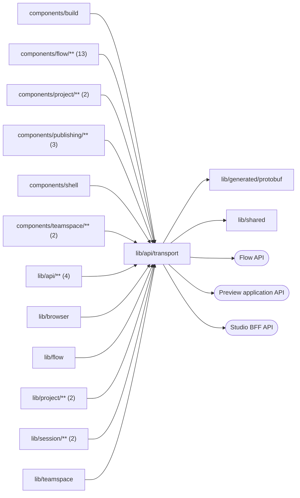

# Browser transport

<!-- BEGIN GENERATED DIRECTORY SUMMARY (scripts/check-readmes.mjs; edit only Purpose) -->
Purpose: The browser network layer owns RPC posts, bounded read retries, snapshot Watches, command recovery, the Flow API client and application URL probes.

Importers: `components/build`, `components/flow/**` (13), `components/project/**` (2), `components/publishing/**` (3), `components/shell`, `components/teamspace/**` (2), `lib/api/**` (4), `lib/browser`, `lib/flow`, `lib/project/**` (2), `lib/session/**` (2) and `lib/teamspace` import this directory.

Imports: it imports `lib/generated/protobuf` and `lib/shared` and calls the Flow, Preview application and Studio BFF APIs.

<!-- END GENERATED DIRECTORY SUMMARY -->

`unary.ts` posts one RPC to `/api/rpc/<Method>`; `read-unary.ts` applies the
read policy below; `watch.ts` opens one
snapshot-first Watch and leaves reconnecting to its caller; `api-error.ts`
holds `ApiError` (of a Studio route or the Flow API), the Flow API's JSON
reader `readFlowApiJson`, `newRequestId` and the one retry rule for idempotent
commands (`PendingCommand`, `retainedAfterFailure`); `flow-api-client.ts` is
the Flow API client of one mounted resource (same-origin requests, CSRF token
and request owner). Only this directory calls `fetch` or `EventSource`.

Browser `Get`/`List` business reads use `readUnary`, whose type excludes
commands and Watches. It retries only typed `ApiError` responses with HTTP
503/504 (the BFF's gRPC `UNAVAILABLE`/`DEADLINE_EXCEEDED` mapping), at most
three times after the first attempt. Backoff is 500/1000/2000 milliseconds
with ±25% jitter. All attempts and delays share a 60-second deadline and the
caller's AbortSignal; changing a target or unmounting cancels the whole read.
Other errors, including deterministic 400/401/403/404/409 rejections, fail
immediately. Writes keep their existing explicit identity and recovery rules.
Resource snapshot Watches keep their existing cursor-based reconnection.

Configuration re-reads retain the last successful snapshot while retrying.
An initial read shows its error only after this policy ends and offers
**Retry configuration**; a loaded configuration retains **Refresh configuration**
after a failed refresh. A new attempt clears the old read error, and an aborted
or superseded attempt cannot replace the current target's state.

Flow API requests retain a 35-second browser backstop and cancel when their
resource or selected Flow changes. Diagnostic history waits and Stream reads
normally receive the server's 408 after its 30-second idle window, then continue
from the same cursor. The backstop also covers Chromium resending a 408 on a
reused HTTP/1.1 connection; it counts as an idle deadline only for these long polls.
