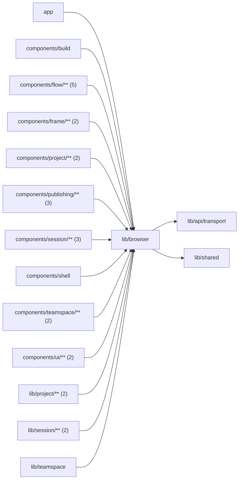

# Browser state

<!-- BEGIN GENERATED DIRECTORY SUMMARY (scripts/check-readmes.mjs; edit only Purpose) -->
Purpose: Browser-only utilities: storage with every stored key, the theme preference, single-flight user actions, URL query updates and paged lists.

Importers: `app`, `components/build`, `components/flow/**` (5), `components/frame/**` (2), `components/project/**` (2), `components/publishing/**` (3), `components/session/**` (3), `components/shell`, `components/teamspace/**` (2), `components/ui/**` (2), `lib/project/**` (2), `lib/session/**` (2) and `lib/teamspace` import this directory.

Imports: it imports `lib/api/transport` and `lib/shared`.

<!-- END GENERATED DIRECTORY SUMMARY -->
