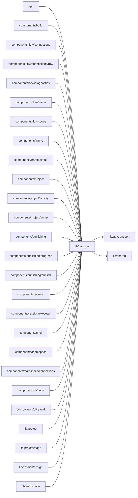

# Browser state

<!-- BEGIN GENERATED DIRECTORY SUMMARY (scripts/check-readmes.mjs; edit only Purpose) -->
Purpose: Browser-only utilities: storage with every stored key, the theme preference, single-flight user actions, URL query updates and paged lists.

Importers: `app`, `components/build`, `components/flow/connections`, `components/flow/connections/row`, `components/flow/diagnostics`, `components/flow/frame`, `components/flow/scope`, `components/frame`, `components/frame/status`, `components/project`, `components/project/activity`, `components/project/setup`, `components/publishing`, `components/publishing/progress`, `components/publishing/publish`, `components/session`, `components/session/executor`, `components/shell`, `components/teamspace`, `components/teamspace/connections`, `components/ui/pane`, `components/ui/reveal`, `lib/project`, `lib/project/stage`, `lib/session/design` and `lib/teamspace` import this directory.

Imports: it imports `lib/api/transport` and `lib/shared`.

<!-- END GENERATED DIRECTORY SUMMARY -->
