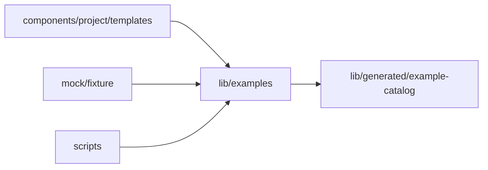

# Bundled examples

<!-- BEGIN GENERATED DIRECTORY SUMMARY (scripts/check-readmes.mjs; edit only Purpose) -->
Purpose: The examples of the application template this Studio was built with and the example search, which ranks them in the browser exactly as the server shortlists them.

Importers: `components/project/templates`, `mock/fixture` and `scripts` import this directory.

Imports: it imports `lib/generated/example-catalog`.

<!-- END GENERATED DIRECTORY SUMMARY -->

Studio reads no example over the network: `make generate-app-template` writes
`lib/generated/example-catalog/example-search.json`, byte for byte the index the server embeds
(`internal/dexai/app/apptemplate`), and Studio bundles it. The index holds what the start page shows of each
example, in catalog order, the search's stop words and synonym groups, and for each search term its postings:
the examples that hold it with a BM25 score in thousandths, which the generator computed over the example's
weighted fields (the title and the apps count three times, the category, the decider, the description and the
card's feature texts once).

| File | Responsibility |
| --- | --- |
| `example-search.ts` | The search, the TypeScript port of `example_search.go`: ASCII words, the stemmer, stop words and synonyms, and the sum of the postings of a text's distinct terms, ties in catalog order. It imports nothing, so `scripts/check-example-search.mjs` runs it in Node as it is. |
| `example-catalog.ts` | The bundled index, checked once, the catalog in the start page's shape, the categories (the server's closed set, which the generator writes to `lib/generated/example-catalog/example-categories.ts`) and the ranking of a description. |

A text in another language than English names no term and ranks nothing. `scripts/check-example-search.mjs`, a
data check in `npm run check`, proves on every labelled request of `app-template/examples/labelled-requests.json`
that this search ranks the examples exactly as the Go search does, and that each expected example is in the
grid's top six.
