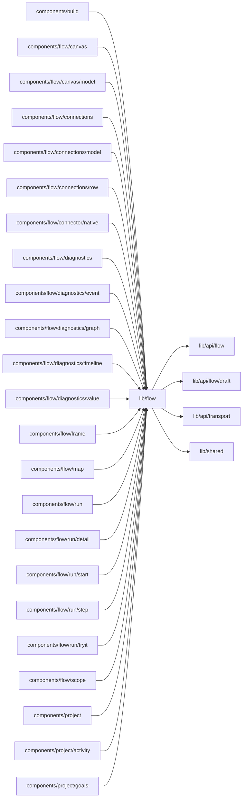

# Flow providers

<!-- BEGIN GENERATED DIRECTORY SUMMARY (scripts/check-readmes.mjs; edit only Purpose) -->
Purpose: The providers the Flow UI reads: the scoped Flow API client, Flow view navigation and the Flow catalog, with the definition revision binding and enum labels.

Importers: `components/build`, `components/flow/canvas`, `components/flow/canvas/model`, `components/flow/connections`, `components/flow/connections/model`, `components/flow/connections/row`, `components/flow/connector/native`, `components/flow/diagnostics`, `components/flow/diagnostics/event`, `components/flow/diagnostics/graph`, `components/flow/diagnostics/timeline`, `components/flow/diagnostics/value`, `components/flow/frame`, `components/flow/map`, `components/flow/run`, `components/flow/run/detail`, `components/flow/run/start`, `components/flow/run/step`, `components/flow/run/tryit`, `components/flow/scope`, `components/project`, `components/project/activity` and `components/project/goals` import this directory.

Imports: it imports `lib/api/flow`, `lib/api/flow/draft`, `lib/api/transport` and `lib/shared`.

<!-- END GENERATED DIRECTORY SUMMARY -->
