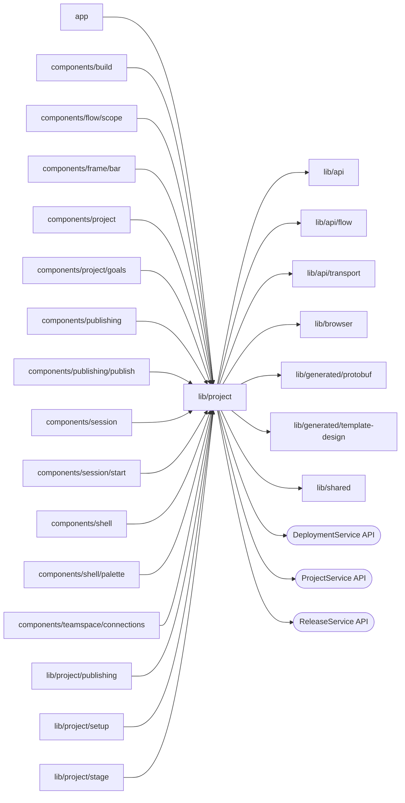

# Project resources

<!-- BEGIN GENERATED DIRECTORY SUMMARY (scripts/check-readmes.mjs; edit only Purpose) -->
Purpose: Project resources: the Project Watch provider and list, resource Watches, release versions, Process definitions, waiting runs, configuration reads, requirement gap names, the pending creation and the generated designs.

Importers: `app`, `components/build`, `components/flow/scope`, `components/frame/bar`, `components/project`, `components/project/goals`, `components/publishing`, `components/publishing/publish`, `components/session`, `components/session/start`, `components/shell`, `components/shell/palette`, `components/teamspace/connections`, `lib/project/publishing`, `lib/project/setup` and `lib/project/stage` import this directory.

Imports: it imports `lib/api`, `lib/api/flow`, `lib/api/transport`, `lib/browser`, `lib/generated/protobuf`, `lib/generated/template-design` and `lib/shared` and calls the `DeploymentService`, `ProjectService` and `ReleaseService` APIs.

<!-- END GENERATED DIRECTORY SUMMARY -->

`initial-template-design.ts` holds the generated designs a Project's first commit
shows before the Preview has built processes: the default template's initial design
for a Project created from a description, and, through `useExampleDefinitions`, the
Flow definitions of the example a Project started from. The latter come from
`lib/generated/template-design/example-designs.ts`, which names each example's tree
and imports its file on first use, so a Builder loads only its own example's file and
the start page none.

`ProcessDefinitionsProvider` reads the Processes of the source the Preview prepared, and
keeps, in memory only, the newest one it read and the last built one before it: while a
newer push builds or failed to build, Preview's processes stay the last built ones and
`lastBuilt` holds their catalog, built as the prepared-source Flow API builds it, which
the Flow tab draws read-only; a new build's `buildChanges` names, by Flow type, the Steps
it added and those whose definition changed against the build read before it (a Step's
node and the nodes under it, the edges that leave them, the resources it reads or waits
on and its group, without source positions). A reload starts with neither.
