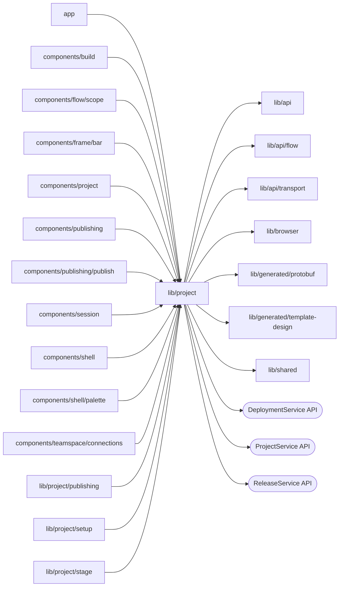

# Project resources

<!-- BEGIN GENERATED DIRECTORY SUMMARY (scripts/check-readmes.mjs; edit only Purpose) -->
Purpose: Project resources: the Project Watch provider and list, resource Watches, release versions, Process definitions, waiting runs, configuration reads, requirement gap names, the pending creation and the template's Design.

Importers: `app`, `components/build`, `components/flow/scope`, `components/frame/bar`, `components/project`, `components/publishing`, `components/publishing/publish`, `components/session`, `components/shell`, `components/shell/palette`, `components/teamspace/connections`, `lib/project/publishing`, `lib/project/setup` and `lib/project/stage` import this directory.

Imports: it imports `lib/api`, `lib/api/flow`, `lib/api/transport`, `lib/browser`, `lib/generated/protobuf`, `lib/generated/template-design` and `lib/shared` and calls the `DeploymentService`, `ProjectService` and `ReleaseService` APIs.

<!-- END GENERATED DIRECTORY SUMMARY -->
