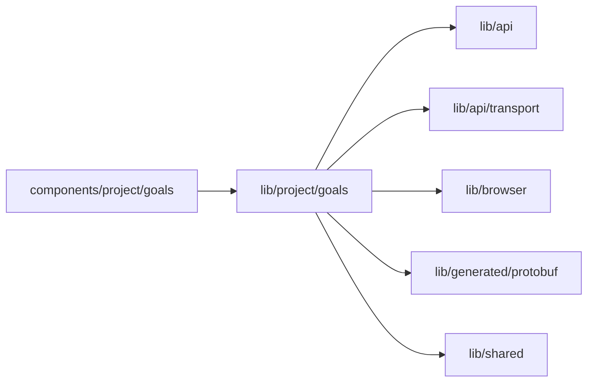

# Goal measurement

<!-- BEGIN GENERATED DIRECTORY SUMMARY (scripts/check-readmes.mjs; edit only Purpose) -->
Purpose: A Project's goal measurement for the Goals tab: the read that follows a running review, Review now, and goal values in their metric's unit.

Importers: `components/project/goals` imports this directory.

Imports: it imports `lib/api`, `lib/api/transport`, `lib/browser`, `lib/generated/protobuf` and `lib/shared`.

<!-- END GENERATED DIRECTORY SUMMARY -->

`useGoalMeasurement` reads `GetEvolve`; NOT_FOUND, before the Project's first Live deployment, is `absent`. While the
measurement names an active review it reads again every 5 seconds until the review ends, for at most 15 minutes from
the read that found it running, and a later read that fails keeps what the page shows. `useReviewNow` sends
`StartEvolveReview` with a request ID that it keeps across a retry whose outcome is unknown
(`retainedAfterFailure`), keeps a refusal as an answer and reads the measurement again after either.

`goal-values.ts` reads a metric's unit from the metric language of the goals file (`rate(…)` a share, a metric over
`ai.usd` dollars, `duration_h` and `wait_h.<Step>` hours, anything else a number), formats values, targets and
guardrail limits in it, picks each goal's value from the newest measured review and its trend from the measured
reviews, and splits the parser's "line <n>: <message>" problems.
