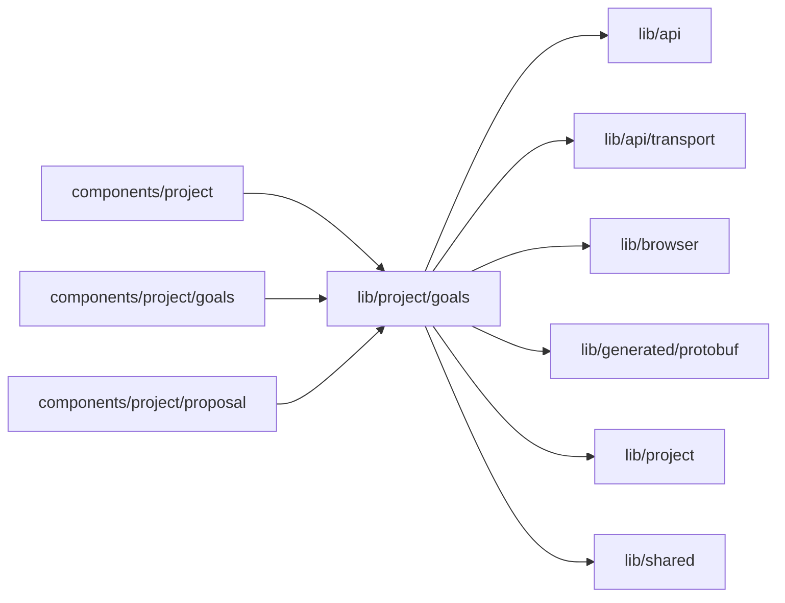

# Goal measurement

<!-- BEGIN GENERATED DIRECTORY SUMMARY (scripts/check-readmes.mjs; edit only Purpose) -->
Purpose: A Project's goal measurement and agent proposals for the Builder: the shared read, Review now, decisions, proposal documents and backtests, and goal values in their unit.

Importers: `components/project`, `components/project/goals` and `components/project/proposal` import this directory.

Imports: it imports `lib/api`, `lib/api/transport`, `lib/browser`, `lib/generated/protobuf`, `lib/project` and `lib/shared`.

<!-- END GENERATED DIRECTORY SUMMARY -->

`EvolveProvider` is the Builder's one read of the measurement, which the Goals tab, its mark and the chat's proposal
card share (`useEvolve`, `useOfferedProposal`), with the proposal decisions; a decision reads it again for all of them,
and so does a new Live revision, since publishing and rolling back move proposals, and a return to the page (focus, or
the tab shown again, at most every 30 seconds), since a scheduled review may have proposed something meanwhile.
`useGoalMeasurement` reads `GetEvolve`; NOT_FOUND, before the Project's first Live deployment, is `absent`. While the
measurement names an active review, or the agent was told of an approval or decline it has yet to carry out
(`agentAtWork`; one it was not told of counts once the person told it in the chat, `toldAgent`), or the measurement has
yet to follow Live (`behindLive`: the Project moves Live first, and the measurement then reads the new build's goals,
stores them with its commit and moves applied and live proposals), it reads again every 5 seconds until that is done,
for at most 15 minutes from the read that found it so; a read that fails meanwhile is tried again, and keeps what the
page shows. `useReviewNow` sends `StartEvolveReview` with a request ID that it keeps across a retry whose
outcome is unknown (`retainedAfterFailure`), keeps a refusal as an answer and reads the measurement again after either.
`useProposalDecision` sends `DecideEvolveProposal` at the revision the card showed, one at a time; the server answers a
repeated decision with the one it recorded, so a retry sends it again, and a STALE_PROPOSAL refusal is kept as an answer
for that proposal with the revision the server found it at, until the next decision or `dismissStale`, and reads the
measurement again. A refusal, and a failure of the last decision, hold only while the proposal stays at that revision
(`stillMarked`): once a read shows it moved on, what they said no longer shows. The last decision also names the card
that sent it, so only that card announces how it went while both show it.

`proposals.ts` picks the offered proposal (the Goals tab's mark) and the one the chat keeps in view (offered, waiting
to ship, or decided while the agent did not get the decision), tells whether an undo proposal of a proposal is Live,
tells whether a refused or failed decision still holds (`stillMarked`), and keeps Why, What changes, Open runs, Risks
and Undo of the agent's document with its headings under the row's. Undo needs nothing from it: the measurement records
the release Live ran just before a proposal went live (`previousLiveReleaseId`). `proposal-backtest.ts` reads the
backtest's JSON (`goals.Backtest`, snake_case) into the runs, the calibration, the estimation and each goal before and
after with the review's direction, tells whether a goal gets better or worse (`goalMovement`: a broken guardrail is
worse; an estimate only when its whole interval moves), and picks the goals the chat's card names: the targeted goal,
then every goal that gets worse, which is never left out, then the others up to the card's limit.
`use-proposal-document.ts` reads a proposal's document (`GetEvolveProposal`) once its row opens.

`goal-values.ts` names a backtest's goal by its statement in Live's goals, or says Live's goals file no longer has it
(`goalStatement`), reads a metric's unit from the metric language of the goals file (`rate(…)` a share, a metric over
`ai.usd` dollars, `duration_h` and `wait_h.<Step>` hours, anything else a number), formats values, targets and
guardrail limits in it, picks each goal's value from the newest review with goal values (a measured review, or one
whose agent review followed the measurement) and its trend from those reviews, and splits the parser's
"line <n>: <message>" problems.
