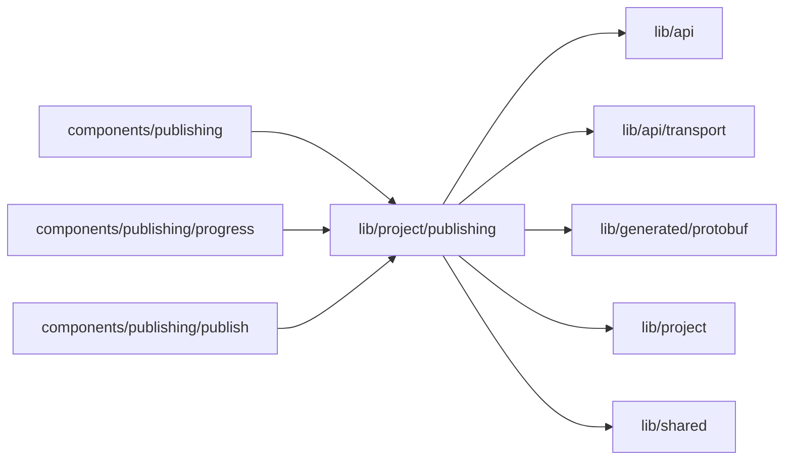

# Publishing state

<!-- BEGIN GENERATED DIRECTORY SUMMARY (scripts/check-readmes.mjs; edit only Purpose) -->
Purpose: A publish's five stages from its phase timings, the publish in progress with its Watches, the build log read, and the Publish popover's version check.

Importers: `components/publishing`, `components/publishing/progress` and `components/publishing/publish` import this directory.

Imports: it imports `lib/api`, `lib/api/transport`, `lib/generated/protobuf`, `lib/project` and `lib/shared`.

<!-- END GENERATED DIRECTORY SUMMARY -->

- `publish-stages.ts` declares the stages once with the phases each records (observability.md,
  Publishing stages), and derives a publish's outcome, each stage's state and span, and what Cancel
  stops now.
- `use-publish-progress.ts` finds the publish a page names (`?release=&build=` or `?deployment=`) or the
  newest one, and follows it through the Release and Deployment Watches while it runs; they close once it
  settles.
- `use-build-log.ts` reads `GetReleaseBuildLog` page by page from its cursor while the log is open,
  no faster than every 2 seconds or `retry_after_ms`; nothing is stored beyond the page.
- `use-publish-check.ts` prepares a version's Release when it has none and reads Live's next publish
  checked against it, with the revisions a publish fences on.
