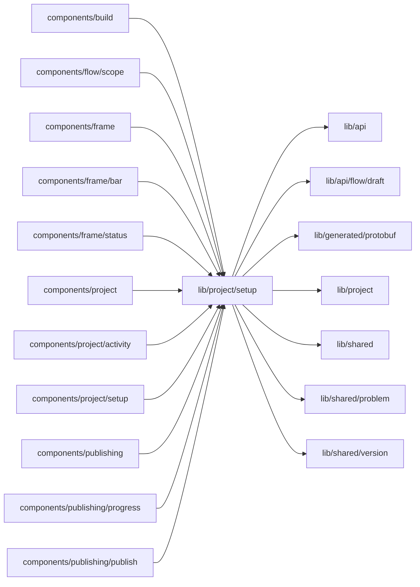

# Setup

<!-- BEGIN GENERATED DIRECTORY SUMMARY (scripts/check-readmes.mjs; edit only Purpose) -->
Purpose: Setup's shared state: each environment's status, the Preview draft, Live's next-publish layer with its items, and the gap links.

Importers: `components/build`, `components/flow/scope`, `components/frame`, `components/frame/bar`, `components/frame/status`, `components/project`, `components/project/activity`, `components/project/setup`, `components/publishing`, `components/publishing/progress` and `components/publishing/publish` import this directory.

Imports: it imports `lib/api`, `lib/api/flow/draft`, `lib/generated/protobuf`, `lib/project`, `lib/shared`, `lib/shared/problem` and `lib/shared/version`.

<!-- END GENERATED DIRECTORY SUMMARY -->

`environment-status.ts` declares the Preview and Live status sets once, in precedence order, with
each value's tone and action. `PreviewDraftProvider.tsx` owns the Preview's configuration read for
the frame and rereads it whenever the autosave queue settles. `configuration-items.ts` maps a
requirement gap to the item it belongs to and the anchor that focuses it, Preview's control or the Next
publish one (`nextPublishGapAnchor`). `use-next-publish.ts` reads Live's next-publish layer, checked
against a Release's source or the Preview's, with each item following Preview or Live's own and how many
wait for a publish, and reads it again whenever its autosave queue settles.
