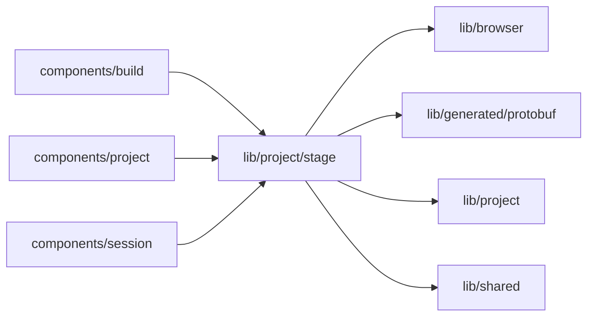

# Project stage

<!-- BEGIN GENERATED DIRECTORY SUMMARY (scripts/check-readmes.mjs; edit only Purpose) -->
Purpose: How far a Project has come, from its first conversation to built and Live, and the Builder tabs it has shown in this browser.

Importers: `components/build`, `components/project` and `components/session` import this directory.

Imports: it imports `lib/browser`, `lib/generated/protobuf`, `lib/project` and `lib/shared`.

<!-- END GENERATED DIRECTORY SUMMARY -->

`ProjectStageProvider` takes the Builder's Session and reads its Project; `useProjectStage()` returns
the stage (`conversation`, `shaping`, `built` or `live`) with the facts behind it: whether processes are
built from the agent's own push (`hasOwnProcesses`), whether a published version runs (`hasPublished`),
whether the agent recorded a version of the requirements card, and whether the Preview has served a page of the agent's
push. `designFirst` says whether the Flow tab may draw a card's Flow design at all: only for a Project that started
from the default template and has no processes built from the agent's own push yet (now, once before in this browser,
or in one of the Preview's newest starts); once processes are built, and for any Project that started from an example,
it shows the real flow only. `buildsOwnHead` says that nothing is built yet and the Preview is to build the Session's
head, the agent's own push or an opened example's setup commit, so the Builder keeps its Building stage and a card
without a design reads as being built. Only a Project created in this browser has a first conversation: the creation page calls
`beginFirstRun`, and the Builder switches once to the standard view when the requirements card arrives or
processes are built, or when a link names another surface or the person picks the first conversation's
"Open the Flow tab" (`leaveFirstRun`). The switch and "built" are
kept per Project in browser storage and never go back.

`useRevealedSurfaces` keeps the tabs a Project has shown, so a tab never disappears once it appeared, and
marks those that appeared since the Project was first shown here until they are opened.
