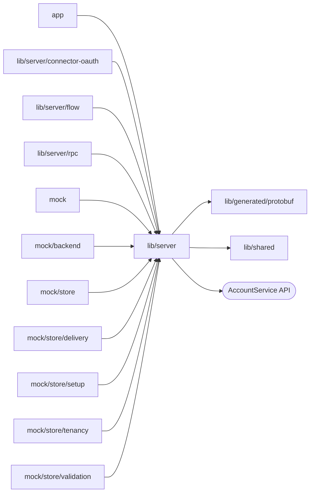

# BFF server

<!-- BEGIN GENERATED DIRECTORY SUMMARY (scripts/check-readmes.mjs; edit only Purpose) -->
Purpose: The server-only BFF core: the gRPC client and its `RpcBackend` seam, the Server-Sent Events relay, `/api/auth`, the caller cookie, same-origin checks and bounded request bodies.

Importers: `app`, `lib/server/connector-oauth`, `lib/server/flow`, `lib/server/rpc`, `mock`, `mock/backend`, `mock/store`, `mock/store/delivery`, `mock/store/setup`, `mock/store/tenancy` and `mock/store/validation` import this directory.

Imports: it imports `lib/generated/protobuf` and `lib/shared` and calls the `AccountService` API.

<!-- END GENERATED DIRECTORY SUMMARY -->

`grpc-client.ts` loads the eleven business services once and holds the
`RpcBackend` seam, `grpcBackend` (`callRpc` and its Watch counterpart) and the
gRPC-to-HTTP error mapping. `event-stream.ts` is the one Server-Sent Events
relay; `auth-handler.ts` serves `/api/auth`. The root never imports `rpc/` or
`flow/`, and nothing a `'use client'` module reaches may import this
directory (`npm run check:modules`).

For the effect-free GetRelease read only, upstream DEADLINE_EXCEEDED and
UNAVAILABLE become HTTP 503 with `Retry-After: 1`. This also covers the BFF's
own 35-second deadline; a slow read never claims a build failed. Other RPCs
retain their status mapping, including command deadlines and caller cancellation.
