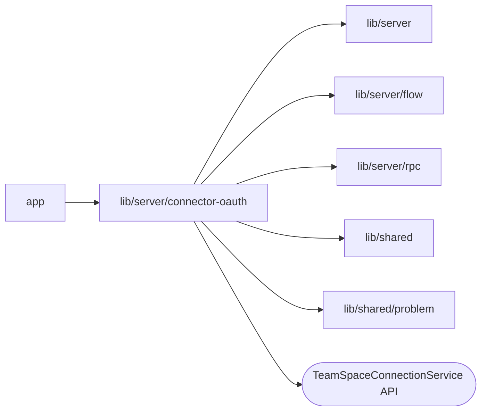

# lib/server/connector-oauth

<!-- BEGIN GENERATED DIRECTORY SUMMARY (scripts/check-readmes.mjs; edit only Purpose) -->
Purpose: Starts a TeamSpace connection's OAuth authorization and completes its provider callback, binding the two with a signed route cookie.

Importers: `app` imports this directory.

Imports: it imports `lib/server`, `lib/server/flow`, `lib/server/rpc`, `lib/shared` and `lib/shared/problem` and calls the `TeamSpaceConnectionService` API.

<!-- END GENERATED DIRECTORY SUMMARY -->

`POST /api/connector-oauth/start` takes a StartTeamSpaceConnectionOAuth
request plus `returnPath`, a path of Studio's own origin. It answers the
provider page to open and sets a version-7 route cookie: host-only, HttpOnly,
SameSite=Lax, Secure on HTTPS, restricted to the callback path, signed with
`BROWSER_SIGNING_KEY`, and binding the actor, the login's digest, the state's
digest, the origin, the TeamSpace connection and the return path for at most
ten minutes. Go owns the provider policy, so the BFF checks only that the
authorization URL is an absolute http or https URL without userinfo or
fragment that carries one state.

`GET /api/connector-oauth/callback` reads that cookie and calls
CompleteTeamSpaceConnectionOAuth, which completes only the caller's own
attempt. Success, and every definitive failure, clears the cookie and returns
to the page with `oauth=success&connection=<id>` or `oauth=failed` and the
refusal's `reason`; a transient failure keeps the cookie, so a reload retries.
Neither RPC is reachable through `/api/rpc`.
