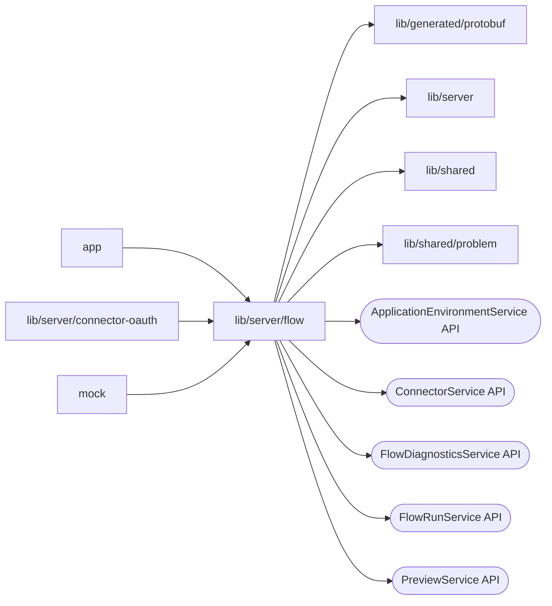

# Flow API routes

<!-- BEGIN GENERATED DIRECTORY SUMMARY (scripts/check-readmes.mjs; edit only Purpose) -->
Purpose: Serves the `/dex` Flow API routes and the Session source catalog: maps each URL to a named Flow API RPC and checks CSRF.

Importers: `app`, `lib/server/connector-oauth` and `mock` import this directory.

Imports: it imports `lib/generated/protobuf`, `lib/server`, `lib/shared` and `lib/shared/problem` and calls the `ApplicationEnvironmentService`, `ConnectorService`, `FlowDiagnosticsService`, `FlowRunService` and `PreviewService` APIs.

<!-- END GENERATED DIRECTORY SUMMARY -->

Diagnostic history waits and Stream reads relay the Go Flow API's 408 document
after its 30-second idle window. The BFF's unary gRPC deadline remains 35 seconds,
so a normal idle read finishes while the call is still live. Request cancellation
still cancels that call; a transport deadline or cancellation remains distinct
from the server's completed idle-read document.
