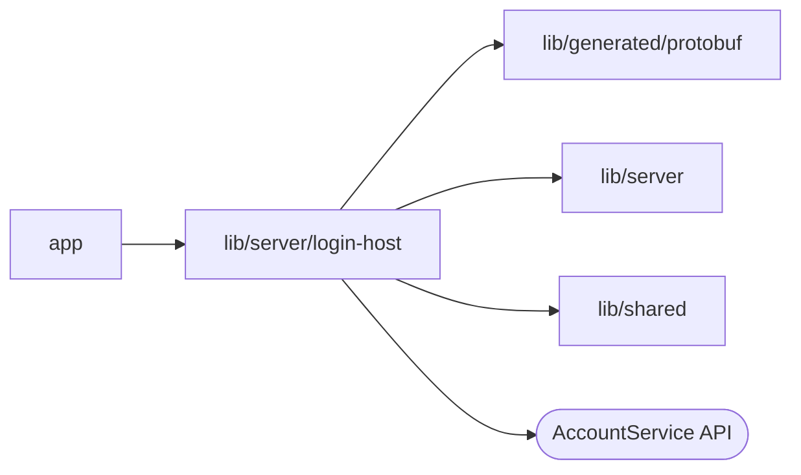

# lib/server/login-host

<!-- BEGIN GENERATED DIRECTORY SUMMARY (scripts/check-readmes.mjs; edit only Purpose) -->
Purpose: Handles shared login forms, browser handoffs, code exchange, host-only transient cookies, and server credentials for first-party products.

Importers: `app` imports this directory.

Imports: it imports `lib/generated/protobuf`, `lib/server` and `lib/shared` and calls the `AccountService` API.

<!-- END GENERATED DIRECTORY SUMMARY -->
