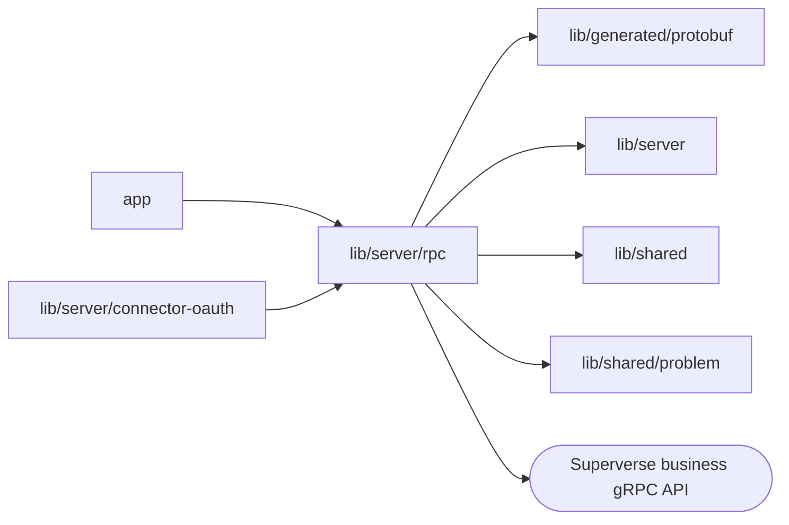

# RPC route

<!-- BEGIN GENERATED DIRECTORY SUMMARY (scripts/check-readmes.mjs; edit only Purpose) -->
Purpose: Serves `/api/rpc/<Method>` for the six browser services through a fail-closed allowlist and a strict descriptor-driven request decoder.

Importers: `app` and `lib/server/connector-oauth` import this directory.

Imports: it imports `lib/generated/protobuf`, `lib/server`, `lib/shared` and `lib/shared/problem` and calls the Superverse business gRPC API.

<!-- END GENERATED DIRECTORY SUMMARY -->
