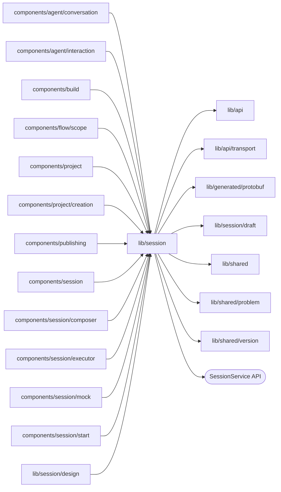

# Session state

<!-- BEGIN GENERATED DIRECTORY SUMMARY (scripts/check-readmes.mjs; edit only Purpose) -->
Purpose: The page-owned Session: `SessionProvider`, its owner hook with the single Watch and the Agent commands, the reducer, the Agent protobuf projection, message merging and the mock scenarios.

Importers: `components/agent/conversation`, `components/agent/interaction`, `components/build`, `components/flow/scope`, `components/project`, `components/project/creation`, `components/publishing`, `components/session`, `components/session/composer`, `components/session/executor`, `components/session/mock`, `components/session/start` and `lib/session/design` import this directory.

Imports: it imports `lib/api`, `lib/api/transport`, `lib/generated/protobuf`, `lib/session/draft`, `lib/shared`, `lib/shared/problem` and `lib/shared/version` and calls the `SessionService` API.

<!-- END GENERATED DIRECTORY SUMMARY -->
