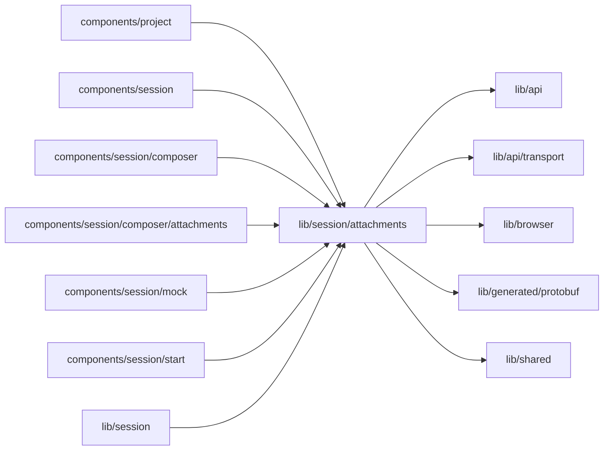

# Attachments

<!-- BEGIN GENERATED DIRECTORY SUMMARY (scripts/check-readmes.mjs; edit only Purpose) -->
Purpose: The composer's attachments: the accepted formats and limits, image normalization and hashing, the upload through a presigned PUT, the chip state machine, its tray hook and the history download links.

Importers: `components/project`, `components/session`, `components/session/composer`, `components/session/composer/attachments`, `components/session/mock`, `components/session/start` and `lib/session` import this directory.

Imports: it imports `lib/api`, `lib/api/transport`, `lib/browser`, `lib/generated/protobuf` and `lib/shared`.

<!-- END GENERATED DIRECTORY SUMMARY -->
